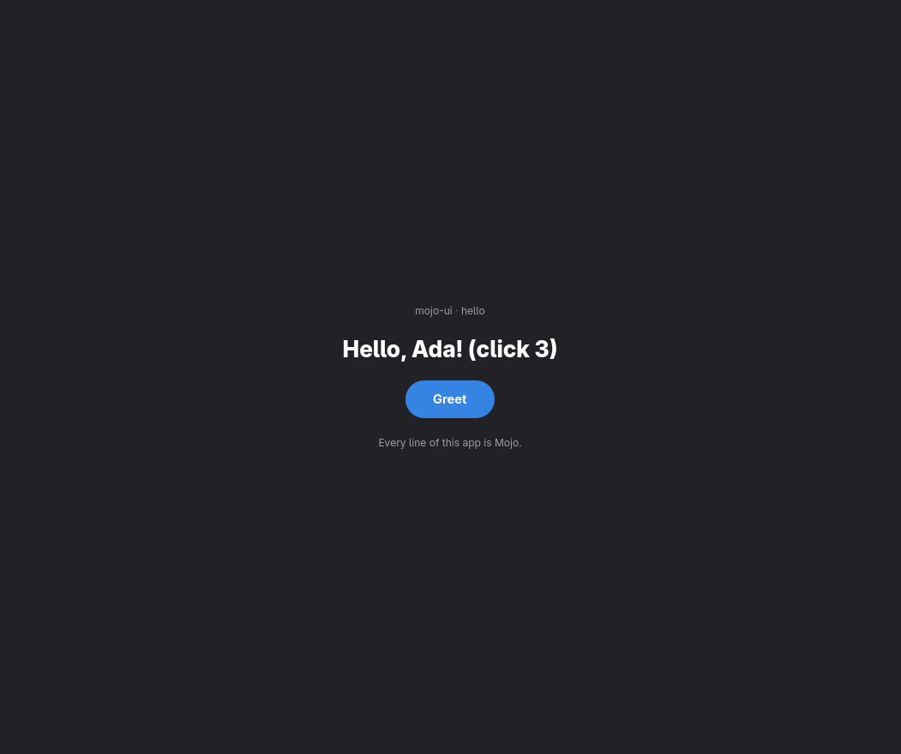

# mojo-ui

Write an app once in **Mojo**, declaratively. Each platform draws it with its **own native controls**: GTK on Linux, AppKit on Mac, UIKit on iPhone.

```mojo
# examples/hello/app.mojo: the whole app, for every platform
from mojoui import App, View, VStack, Text, Button, TITLE, CAPTION, PROMINENT

comptime GREET = 1

struct Main(App):
    var clicks: Int

    def __init__(out self):
        self.clicks = 0

    def title(self) -> String:
        return "HelloMojo"

    def update(mut self, message: Int):
        if message == GREET:
            self.clicks += 1

    def view(self) -> View:
        return VStack(
            Text("Hello, Ada! (click " + String(self.clicks) + ")", style=TITLE),
            Button("Greet", on_tap=GREET, style=PROMINENT),
        )
```

(Slightly trimmed; the real file is `examples/hello/app.mojo`.) `view()` describes the whole screen; `update()` changes the state when a button sends its message. After every tap, mojoui compares the new screen with the old one: if only text changed it updates just those controls, and if rows appeared or disappeared it rebuilds the content.



## Run it

```bash
pixi install                      # Mojo 1.1 and the Apple linker (via pixi.toml)
scripts/build.sh hello all        # Linux, Mac and iPhone builds of examples/hello/app.mojo
scripts/check                     # rebuilds and checks every milestone in GOAL.md
```

| Platform | Native toolkit | How to run |
|---|---|---|
| **Linux** | GTK4 + libadwaita | `scripts/build.sh hello linux && build/hello/linux/hello` |
| **Mac** (Apple Silicon) | AppKit | copy `build/hello/mac/HelloMojo-mac.zip` to the Mac, unzip, open. See `apple/README.md` |
| **iPhone** | UIKit (Liquid Glass buttons on iOS 26) | `apple/install_iphone.sh` (free Apple ID). See `apple/README.md` |

A second example with rows that come and go: `examples/todo/app.mojo` (`scripts/build.sh todo all`).

## Write your own app
1. Make a folder in `examples/` with an `app.mojo` that defines `struct Main(App)`: `__init__`, `title()`, `update(message)`, `view()`.
2. Build blocks: `VStack(...)`, `HStack(...)` (also from a `List[View]` for rows), `Text(text, style=TITLE|HEADLINE|BODY|CAPTION)`, `Button(title, on_tap=MESSAGE, style=PROMINENT|PLAIN)`, `Spacer()`.
3. `scripts/build.sh` with the folder name, e.g. `scripts/build.sh hello all`.

The app file imports only `mojoui`; it never touches GTK, AppKit or UIKit.

## How it works
- `mojoui/view.mojo`: the building blocks; a screen is a flat list of nodes.
- `mojoui/diff.mojo`: compares two screens → small patches or "rebuild".
- `mojoui/app.mojo`: the `App` trait and the update loop shared by every platform.
- `mojoui/hosts/`: one native renderer per platform: `gtk.mojo`, `appkit.mojo`, `uikit.mojo`. The Apple ones call AppKit/UIKit through the Objective-C runtime (`objc.mojo`), so there's no Swift or C anywhere.
- `hosts/`: tiny entry points that import your `app.mojo` and start the right renderer.

## Status
- **Linux:** runs here. `scripts/check` taps the real GTK buttons and reads the real labels back.
- **Mac and iPhone:** build, link and sign here, and pass symbol, entry-point and signature checks. **Not yet run on real hardware**.
- Not yet: text input, images, lists that scroll, web, Android, Windows. See `ROADMAP.md`.

History: `EXPERIMENTS.md` (what was tried), `docs/decisions.md`, `docs/journal.md`, `docs/goals/` (earlier goals and reports).
