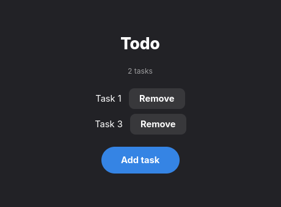
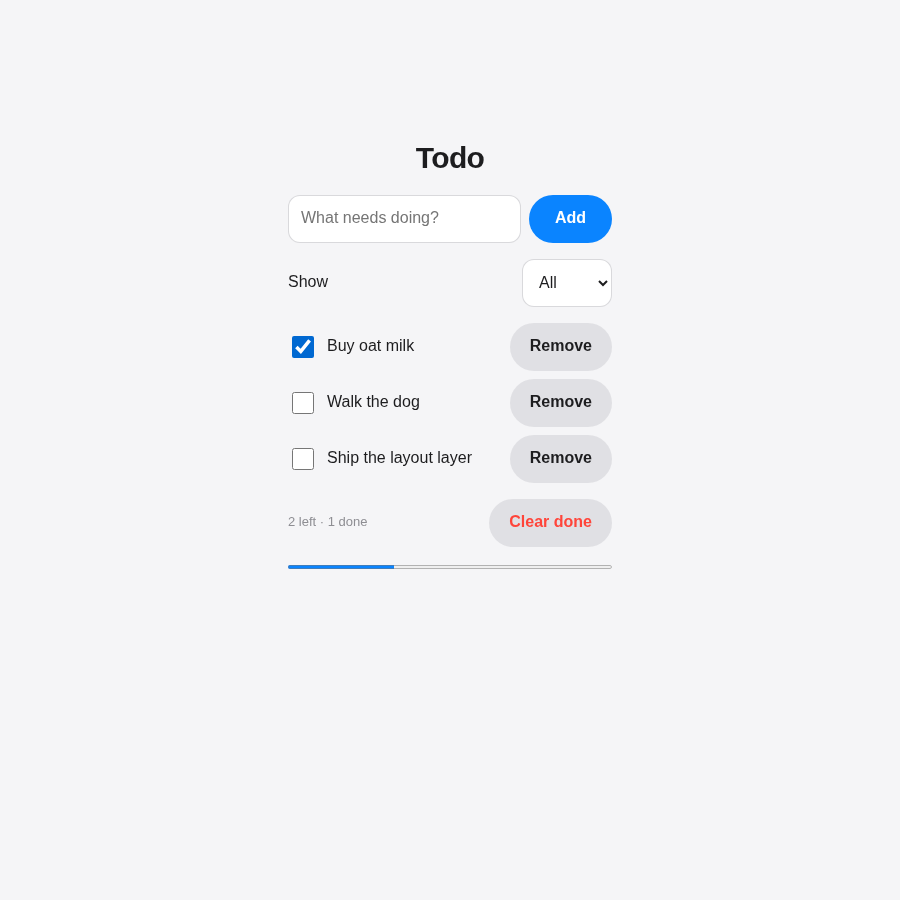
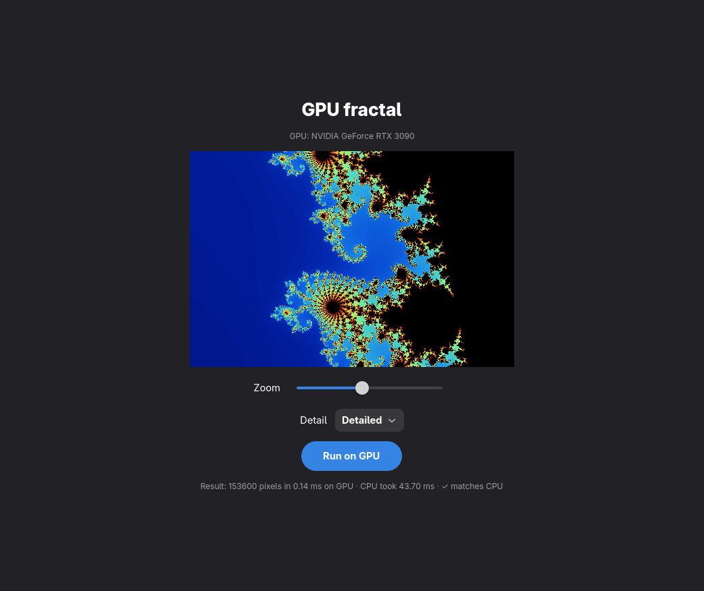
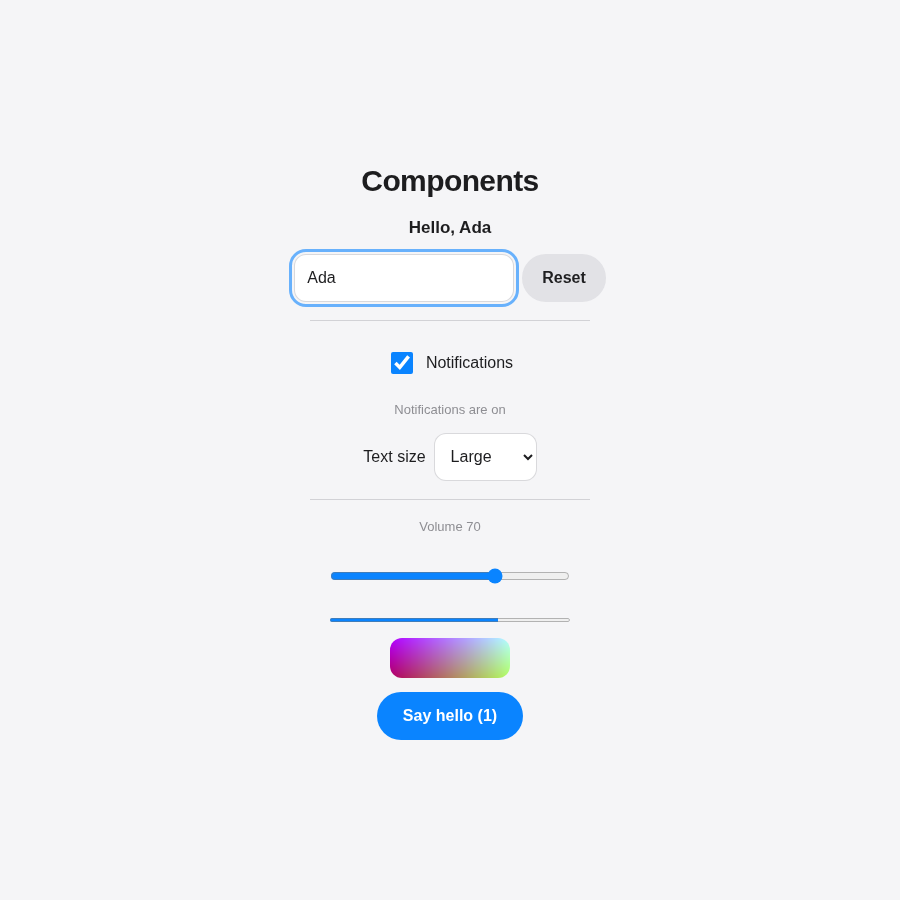
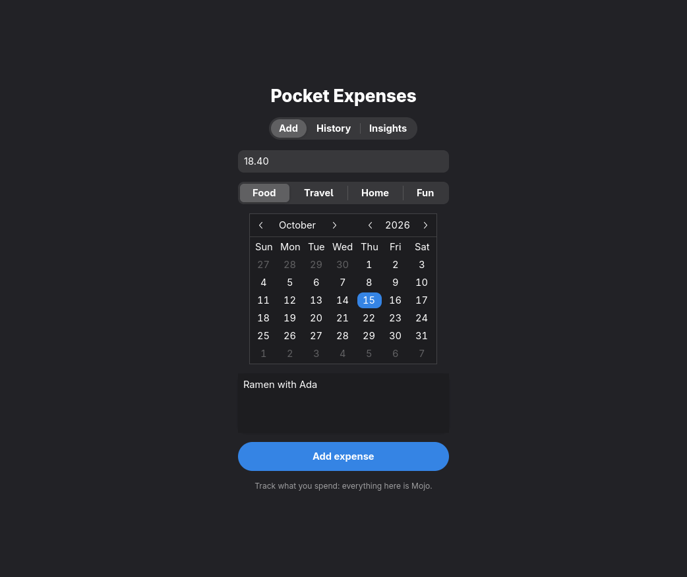
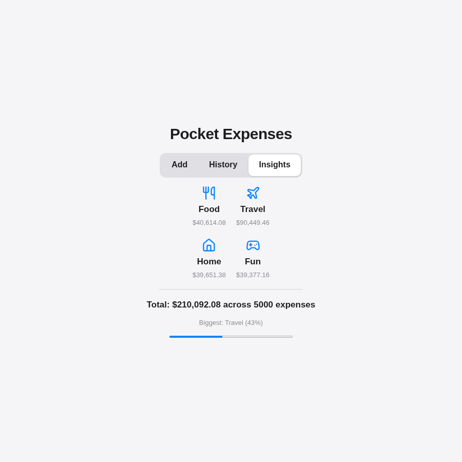

# mojo-ui

Write an app once in **Mojo**, declaratively. Each platform draws it with its **own native controls**: GTK on Linux, plain HTML on the **Web** (served by FastHTML), AppKit on Mac, UIKit on iPhone. A Mojo function can even run on the **GPU** to make what you see.

```mojo
# examples/todo/app.mojo (trimmed): one file, every platform
struct Main(App):
    var tasks: List[Task]
    var draft: String
    ...
    def update(mut self, event: Event):
        if event.message == DRAFT:
            self.draft = event.text
        elif event.message == ADD:  # Return carries the field's text; the Add button uses the draft
            var title = event.text if event.text != "" else self.draft
            self.tasks.append(Task(self.next_id, title, False))
        ...

    def view(self) -> View:
        return VStack(
            Text("Todo", style=TITLE),
            HStack(
                TextField(self.draft, placeholder="What needs doing?", on_change=DRAFT, on_submit=ADD),
                Button("Add", on_tap=ADD, style=PROMINENT),
            ),
            HStack(Text("Show"), Dropdown(filters, self.filter, on_select=FILTER)),
            Scroll(VStack(rows, spacing=8), height=260),
            ProgressBar(percent),
        )
```

`view()` describes the whole screen; `update()` changes the state when something happens. After every event, mojoui compares the new screen with the old one: if only text or values changed it updates just those controls, and if rows came or went it rebuilds the content.

| Linux (GTK) | Web (FastHTML) |
|---|---|
|  |  |
|  |  |
|  |  |

These are real screenshots, rendered by GTK and by Chromium from the same Mojo files.

## Run it

```bash
pixi install                          # Mojo 1.1, MAX (GPU), FastHTML, linker tools (pixi.toml)
scripts/build.sh todo all             # every platform the example supports
scripts/check                         # rebuilds everything and checks every milestone in GOAL.md
```

| Platform | Native toolkit | Run it | Status |
|---|---|---|---|
| **Linux** | GTK4 + libadwaita | `scripts/build.sh todo linux && build/todo/linux/todo` | runs; tested here |
| **Web** | HTML controls + HTMX, served by FastHTML | `scripts/build.sh todo web && pixi run python mojoui/hosts/web.py build/todo/web` → http://127.0.0.1:5001 | runs; tested in Chromium |
| **Mac** (Apple Silicon) | AppKit | `scripts/build.sh todo mac`, copy the zip to your Mac (see `apple/README.md`) | builds + signs; not yet run on a Mac |
| **iPhone** | UIKit (Liquid Glass on iOS 26) | `apple/install_iphone.sh todo` (free Apple ID) | builds + signs; not yet run on an iPhone |
| **Android** | (planned: Android views via JNI) | `scripts/build.sh todo android` builds the arm64 library | exploration; see `docs/android.md` |
| **Windows** | use the Web version | | no Mojo for Windows yet |

On the web, the Mojo app runs on the server inside Python (FastHTML), compiled as a Python module, so Python libraries and the JS ecosystem are both at hand. One app state per browser tab.

## Components

| Component | Does | Linux | Web | Mac | iPhone |
|---|---|---|---|---|---|
| `Text(text, style=TITLE\|HEADLINE\|BODY\|CAPTION)` | a label | GtkLabel | h1/h3/p | NSTextField label | UILabel (Dynamic Type) |
| `Button(title, on_tap=, style=PLAIN\|PROMINENT\|DESTRUCTIVE)` | sends a message | GtkButton | button | NSButton | UIButton (glass) |
| `TextField(value, placeholder=, on_change=, on_submit=)` | one line of text; `event.text` | GtkEntry | input | NSTextField | UITextField |
| `Toggle(label, on, on_toggle=)` | on/off; `event.number` 1/0 | GtkCheckButton | checkbox | checkbox | UISwitch |
| `Dropdown(options, selected, on_select=)` | pick one; `event.number`, `event.text` | GtkDropDown | select | NSPopUpButton | menu button |
| `Slider(value, on_change=)` | 0–100 | GtkScale | range | NSSlider | UISlider |
| `ProgressBar(value)` | 0–100 | GtkProgressBar | progress | NSProgressIndicator | UIProgressView |
| `Image(pixels, width, height)` | RGBA pixels | GtkPicture | PNG img | NSImageView | UIImageView |
| `Segmented(options, selected, on_select=)` | a few joined choices | AdwToggleGroup | radio buttons styled as a segmented control | NSSegmentedControl | UISegmentedControl |
| `Radio(options, selected, on_select=)` | pick one from a list | GtkCheckButton group | radio inputs | NSButton radios | buttons with circle symbols |
| `TextArea(value, placeholder=, on_change=, height=)` | several lines of text | GtkTextView | textarea | NSTextView | UITextView |
| `Alert(title, message, buttons, on_choose=)` | a modal question, shown while it's in the view; `event.number` = button | AdwAlertDialog | dialog | NSAlert | UIAlertController |
| `Tabs(sections, selected, on_select=)` | switch sections | AdwToggleGroup | tabs (radio inputs) | NSSegmentedControl | UISegmentedControl |
| `NavBar(title, on_back=)` | a screen's title bar, with Back | header box + back button | header | back button + title | UINavigationBar |
| `DatePicker("YYYY-MM-DD", on_change=)` | pick a date | GtkCalendar | input type=date | NSDatePicker | UIDatePicker (compact) |
| `Icon(name, size=)` | one of the shared icons (`ICON_NAMES`) | Adwaita symbolic icons | Lucide SVG (vendored) | SF Symbols | SF Symbols |
| `Grid(items, columns)` | items in rows of N | GtkGrid | CSS grid | rows of NSStackView | rows of UIStackView |
| `LazyList(count, list_id, on_tap=)` | a long list; only rows on screen are built, from `App.row(list_id, index)` | GtkListView | windowed rows fetched while scrolling | NSTableView data source | UITableView data source |
| `VStack(...)`, `HStack(...)` | layout; also from a `List[View]` for rows | GtkBox | flexbox | NSStackView | UIStackView |
| `Scroll(view, height=)` | scrolls tall content | GtkScrolledWindow | overflow | NSScrollView | UIScrollView |
| `Divider()`, `Spacer()` | a line; empty space | | | | |

See them in `examples/gallery/app.mojo` and `examples/kitchen/app.mojo`.

## Examples
- `examples/hello/app.mojo`: the smallest app.
- `examples/gallery/app.mojo`: every component, wired to some state.
- `examples/kitchen/app.mojo`: every component added in goal 4 (tabs, a details screen, alert, date, icons, grid, a 10,000-row list).
- `examples/expenses/app.mojo`: **Pocket Expenses**, a small real app using all of them:
  - add an expense (amount, category, date, note);
  - browse 5,000 of them in a list that only draws what's on screen;
  - open one, and confirm deleting it;
  - see totals by category in a grid with icons.
- `examples/todo/app.mojo`: a real todo: type and press Return or Add, tick tasks done, filter All/Active/Done, remove, clear done.
- `examples/gpu/app.mojo`: a **GPU** fractal. A plain Mojo function, `mandelbrot(x, y, …)`, runs once per pixel on the NVIDIA GPU via `mojoui/gpu.mojo`: 480×320 pixels in about 0.1 ms, against about 40–80 ms on the CPU, and checked to match the CPU pixel for pixel. Linux and web (it needs an NVIDIA/AMD GPU).

## Write your own app
1. Make a folder in `examples/` with an `app.mojo` that defines `struct Main(App)`: `__init__`, `title()`, `update(event)`, `view()`.
2. Messages are `Int` constants (`comptime ADD = 1`); `event.text` and `event.number` carry values.
3. Build with `scripts/build.sh` and the folder name, e.g. `scripts/build.sh hello all`. An optional `platforms` file in the folder limits which platforms `all` means.

The app file imports only `mojoui`; it never touches GTK, HTML, AppKit or UIKit (`scripts/check` enforces this).

## How it works
- `mojoui/view.mojo`: the building blocks; a screen is a flat list of nodes.
- `mojoui/diff.mojo`: compares two screens → small patches or "rebuild".
- `mojoui/app.mojo`: the `App` trait, `Event`, and the update loop every platform shares.
- `mojoui/hosts/`: one native renderer per platform:
  - `gtk.mojo` (Linux);
  - `web.mojo` + `web.py` (FastHTML; htmx vendored in `mojoui/hosts/static/`);
  - `appkit.mojo` and `uikit.mojo` (Apple). These call the frameworks through the Objective-C runtime (`objc.mojo`), so there's no Swift or C anywhere.
- `mojoui/gpu.mojo`: run a Mojo function per pixel on the GPU.
- `hosts/`: tiny entry points that import your `app.mojo` and start the right renderer.
- `scripts/build.sh` builds; `scripts/check` proves; `scripts/drive.py` drives the web app in headless Chromium using the same test steps as the GTK test mode.

## Status and limits
- **Runs here:** Linux and the web, including the GPU example. `scripts/check` drives the real widgets: GTK through its signals, the browser through Playwright. It reads them back and requires GTK and the web to end in identical states.
- **Mac and iPhone:** they compile, link and sign here. A reviewer checked the compiled code for every native call that passes or returns floating-point values or rectangles, plus the selectors and constants. **They haven't been run on real hardware yet.**
- **Android:** a real arm64 library builds. Drawing with Android views and receiving taps needs a decision and Google's SDK licence: `docs/android.md`.
- **Not yet:** controls inside lazy-list rows (rows are text plus one tap), a bottom tab bar on iPhone (tabs are a segmented switcher at the top), accessibility labels beyond the platforms' defaults, and JS "islands" on the web.
- **Limits:** up to 65,535 nodes per screen; Mac/iPhone keep replaced controls in memory (fine for small apps).

History: `EXPERIMENTS.md` (what was tried), `docs/decisions.md`, `docs/journal.md`, `docs/goals/` (earlier goals, reports and checkers).
