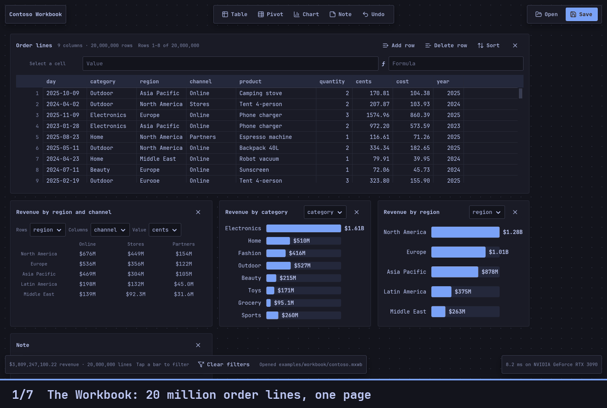
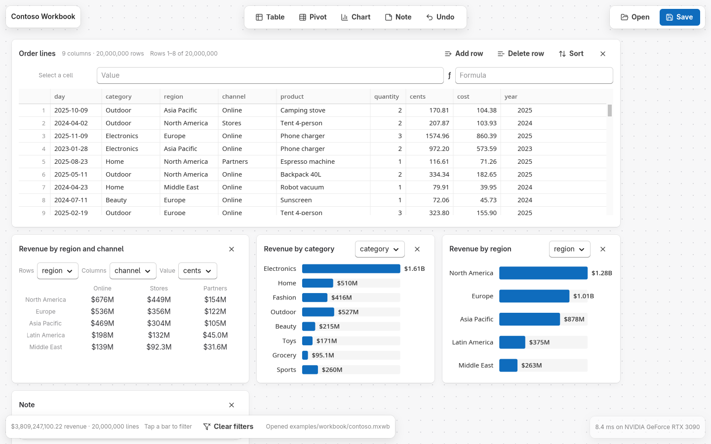
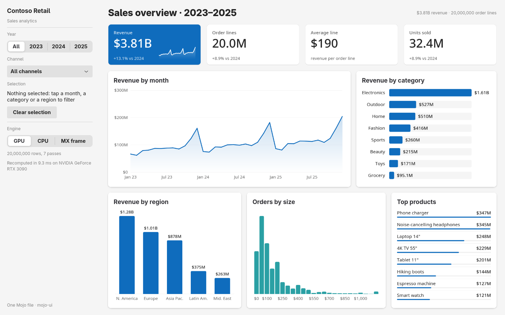
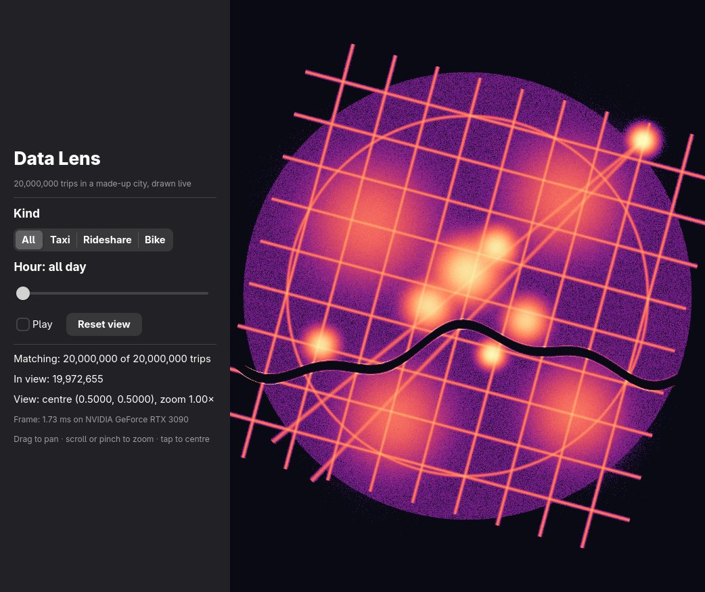
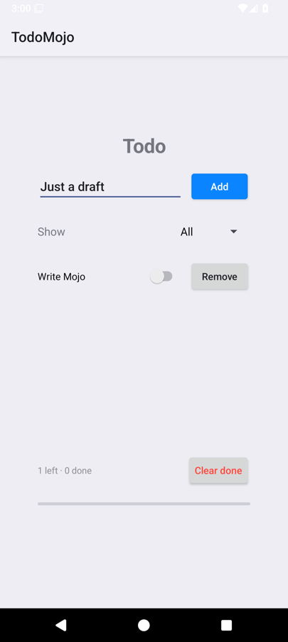
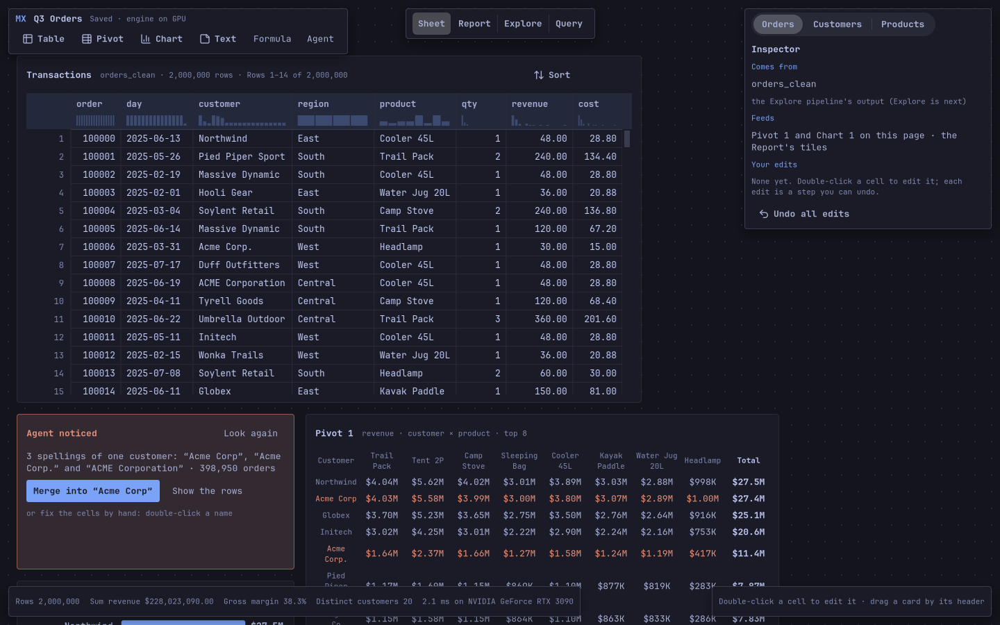
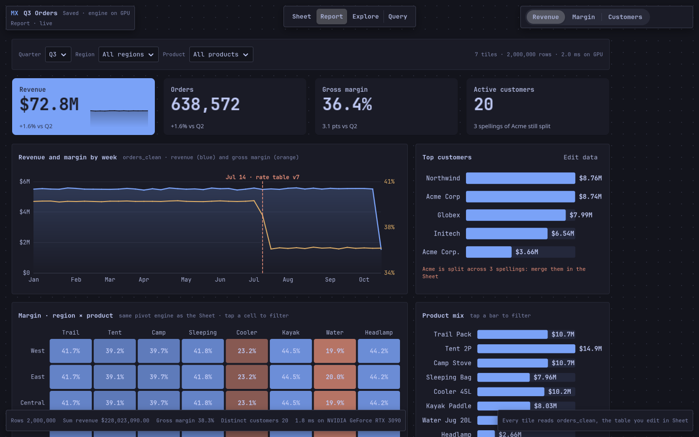
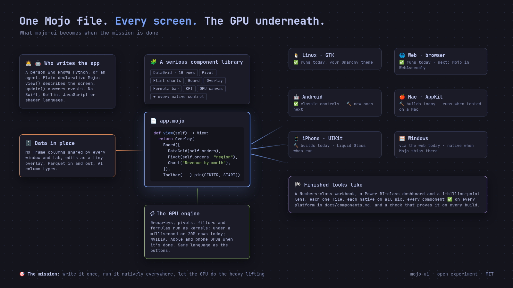
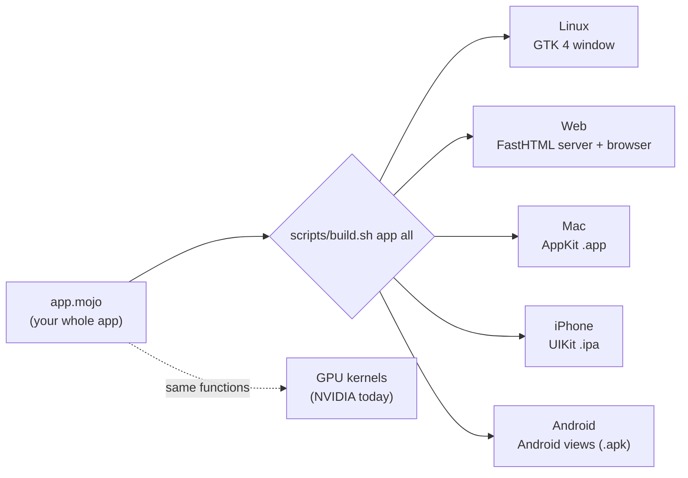
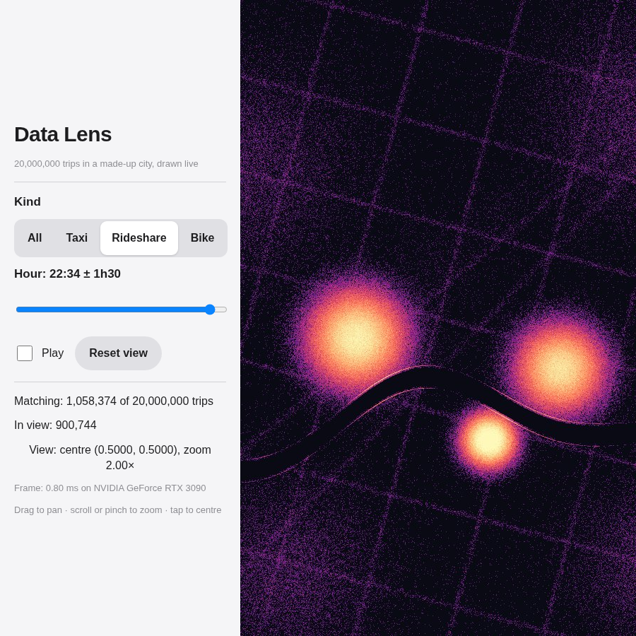

# mojo-ui

<p align="center">
  <a href="https://github.com/abhisheksreesaila/mxapp/blob/main/LICENSE"></a>
  
  
  
  <a href="https://abhisheksreesaila.github.io/mxapp/gallery/"></a>
</p>

> ## 🎯 The mission
> **Write an app once, in one readable language, and get a real native app on every screen** 🐧 Linux · 🌐 Web · 🤖 Android · 🍎 Mac · 📱 iPhone, **with the GPU ⚡ doing the heavy lifting** in that same language.
> Not a toy with buttons: a growing library of **serious components** 🧩 (a data grid over millions of rows, pivots, Flint charts, a free-form page) so that a person 🧑‍💻, or an agent 🤖, can build a Numbers-class app in one file.

## 💡 What this is
- **One file, every platform.** `app.mojo` describes the screen (`view()`) and answers events (`update()`); each platform draws it with **its own native controls** (GTK, HTML, Android views, AppKit, UIKit). No Swift, no Kotlin, no app JavaScript, no shader language.
- **The GPU in the same language.** Group-bys, pivots, filters and formula columns run as Mojo GPU kernels: under a millisecond over 20 million rows on an NVIDIA card.
- **Components first.** Every feature starts by asking which components it needs; they're built in `mojoui/` and tracked per platform in a generated matrix, so the library grows, not the apps.

## 🎬 The showcase



<table>
<tr>
<td width="50%"><a href="docs/morning.md"></a><br><b>🧮 The Workbook</b> · tables, pivots, charts and notes on a free-form page, one GPU engine, 20M rows · <code>scripts/workbook.sh</code></td>
<td width="50%"><a href="#showcase-analytics-on-the-gpu"></a><br><b>📊 Analytics</b> · a Power BI-style dashboard re-aggregated in 6–9 ms per click · <code>examples/analytics/app.mojo</code></td>
</tr>
<tr>
<td><a href="#the-hybrid-native-controls-plus-a-gpu-canvas"></a><br><b>🔭 Data Lens</b> · 20 million points, 1.5 ms a frame on the GPU · <code>examples/lens/app.mojo</code></td>
<td><a href="docs/android.md"></a><br><b>🤖 Android</b> · the same todo file as real Android views · <code>examples/todo/app.mojo</code></td>
</tr>
<tr>
<td><a href="docs/goals/11-report.md"></a><br><b>🧪 MX Studio · Sheet</b> · a 2M-row ledger you edit in place; a finding merges three spellings of a customer · <code>examples/mxstudio</code></td>
<td><a href="docs/goals/12-report.md"></a><br><b>📈 MX Studio · Report</b> · the same ledger as a dashboard; the GPU finds why margin fell after Jul 14 · <code>examples/mxstudio</code></td>
</tr>
</table>

**[Open the gallery →](https://abhisheksreesaila.github.io/mxapp/gallery/)** · [the two-minute Workbook walkthrough](docs/morning.md) · [Mojo in the browser: the wasm spike](docs/wasm.md)

## 📍 Where it stands today
Every ✅ below is run by `scripts/check` on that platform; 🔨 builds but hasn't run there; ❌ isn't built yet. The full per-component matrix is **[docs/components.md](docs/components.md)** (generated from the code; the check fails if it's stale).

| Platform | ✅ proven | 🔨 built, not run | ❌ missing | Notes |
|---|---|---|---|---|
| 🐧 **Linux** (GTK 4) | 52 | 0 | 0 | every component, gesture and theme; your Omarchy theme; spreadsheet keys |
| 🌐 **Web** (FastHTML) | 52 | 0 | 0 | the same results as Linux, checked in Chromium |
| 🤖 **Android** (views over JNI) | 19 | 11 | 22 | runs the classic controls on the emulator; the Workbook's new components not yet |
| 🍎 **Mac** (AppKit) | 0 | 30 | 22 | builds and signs; not run on a Mac yet |
| 📱 **iPhone** (UIKit) | 0 | 30 | 22 | builds and signs; not run on an iPhone yet |
| ⚡ **GPU** | NVIDIA | | | Apple and phone GPUs use the CPU path for now |

Measured on this machine: a page recompute in ~8 ms, a grid redraw in ~6 ms, a GPU group-by under 1 ms, a sort of 20M rows in 0.3–2 s.

## 🚀 What it becomes



**When it's done**, a person or an agent writes one `app.mojo` and gets:
- 🧮 a **Numbers-class workbook**, a **Power BI-class dashboard** and a **billion-point lens**, each a single file;
- 🧩 every component ✅ on every platform in the matrix: `DataGrid`, `PivotTable`, `Chart`, `Board`, `Overlay` next to every native control;
- ⚡ the GPU on **NVIDIA, Apple and phones**, with data from **MX frame** shared by every window and tab;
- 🌐 the web running **Mojo in WebAssembly** in the browser, and 🪟 Windows natively when Mojo ships there.

**What's left to get there:**
1. 🧪 MX Studio's other modes: Explore, Query and the agent's tools (most wait for MX frame: `docs/plans/needs-mxframe.md`).
2. 🤖 🍎 📱 Bring Board, Overlay, the new gestures, keys and themes to Android, then run Mac and iPhone on real hardware (keys run on Linux and the web: [docs/report.md](docs/report.md)).
3. 🎨 Cell formatting, column-first (`docs/plans/formatting.md`).
4. ⚡ Apple and phone GPUs; Mojo in WebAssembly.

## One file, every platform

The diagram: one `app.mojo`, one build command, a native app per platform.



## Why

Every app team today writes the same app several times: Swift for iPhone and Mac, Kotlin for Android, TypeScript for the web, sometimes C++ or Rust for the fast parts. Then they keep them in sync forever.

Cross-platform frameworks fix the "several times" part, but each asks you to give something up:

- **Draw everything yourself** (Flutter, most Rust GUI kits): one codebase, but the app doesn't look or behave quite like the platform, and the framework has to rebuild accessibility and text input itself.
- **Wrap a web page** (Electron, Tauri): easy, but it's a browser in a box, and the fast parts are written in a second language.
- **Drive native widgets from a scripting language** (React Native): native look, but a JavaScript runtime sits between your code and the screen.

And in none of them is the **GPU code** normally written in the same language as the buttons (Rust has experimental options such as rust-gpu). Charts over millions of rows, image filters and on-device AI all end up in a separate shader or CUDA language, behind a boundary that copies data.

**mojo-ui's bet:** one language, Mojo, that is as easy to read as Python, compiles to native code like C++ or Rust, and can run the same functions on the GPU. You describe the screen; each platform draws it with **its own native controls**; the heavy lifting runs on the GPU when there is one. No Swift, no Kotlin, no app JavaScript, no shader language. (The framework itself has one 78-line Java file, because Android only calls Java objects back.)

Here is a complete app in one file: no project setup, no platform folders.

```mojo
from mojoui import App, Event, View, VStack, Text, Button, TITLE, PROMINENT

comptime GREET = 1                         # a message: "the Greet button was tapped"


struct Main(App):
    var clicks: Int                        # the app's state

    def __init__(out self):
        self.clicks = 0

    def title(self) -> String:
        return "Hello"

    def update(mut self, event: Event):    # state changes only here
        if event.message == GREET:
            self.clicks += 1

    def view(self) -> View:                # the screen, described from the state
        return VStack(
            Text("Hello, Ada! (" + String(self.clicks) + ")", style=TITLE),
            Button("Greet", on_tap=GREET, style=PROMINENT),
        )
```

```bash
scripts/build.sh hello all          # → Linux app, web module, Mac app, iPhone app
scripts/build.sh hello android      # → Android app (.apk)
```

That's the whole model, the same one as Elm, SwiftUI and React: **state → `view()` → screen**, and **tap → `update()` → new state**. You never touch GTK, HTML, AppKit or UIKit; `scripts/check` enforces it. (This is a trimmed `examples/hello/app.mojo`.)

On Linux the Greet button is a GTK button and on the web an HTML `<button>`; the Mac and iPhone builds make an `NSButton` and a `UIButton` (Liquid Glass on iOS 26), though those haven't run on real hardware yet. Native widgets bring their platform's own look, keyboard handling, text input and screen-reader support, instead of an imitation.

## Showcase: analytics on the GPU

`examples/analytics/app.mojo` is a Power BI-style dashboard in one Mojo file: **20 million order lines re-aggregated every time you click**, with KPIs, revenue by month, category and region, order sizes and top products. Tap a bar, a column or a month and every other chart filters (crossfiltering).

- **Every chart is a [Flint](https://microsoft.github.io/flint-chart/) spec**, the chart language Microsoft built for AI agents. mojoui draws Flint specs natively (the same pixels on every platform), and the same specs run through Flint's own Vega-Lite backend: all nine are checked that way.
- **Three engines behind one switch:** Mojo GPU kernels (**6–9 ms** for all seven aggregations over 20M rows, depending on the filters), the same functions on one CPU core (about 750 ms), and **MX frame**, a Mojo dataframe engine (about 115 ms on the CPU). A test compares every one of the seven results across all three engines: they agree to the cent.
- **Controls in Fluent 2** on Linux and the web, from one design setting (`design() -> FLUENT`).

```bash
scripts/build.sh analytics linux && build/analytics/linux/analytics           # native window (Linux)
scripts/build.sh analytics web && pixi run python mojoui/hosts/web.py build/analytics/web   # → http://127.0.0.1:5001
```

Linux and the web for now. The Mac version is waiting on a Python-free MX frame API (`docs/mxframe-mojo-api.md`). On the web the 20M rows are built once per server process and shared by every tab (`App.init_shared()`), so many viewers can sit on one GPU.

## Showcase: the Workbook

`examples/workbook/app.mojo` is a Numbers-style page over the same engine: **tables, pivots, charts and notes side by side, sharing one set of 20 million rows**. Columns, never cell addresses.


- **Edit a cell, add a row, delete a row, sort, undo.** Edits never copy the data: a session keeps a sparse overlay, the GPU aggregates the shared rows, and the overlay's deltas are applied exactly (`mojoui/frame.mojo`, `frame_gpu.mojo`).
- **Formula columns** typed as text (`margin = cents - cost`, `bin = min(cents // 50, 23)`): a column-level dependency graph, evaluated inside the GPU group-by kernel, so they cost no memory.
- **Pivots** are run-time group-bys on the GPU (rows × columns × value, about a millisecond for 20M rows); **charts** are Flint specs; tap a bar and everything else filters.
- **Drag objects** by their header, resize by the corner, snap to an 8-point grid (`Board`, a new container); narrow windows and phones show the objects as a list.
- **Save/Open** a workbook folder: `workbook.json` (objects, formulas, your edits) plus Parquet for tables without a reproducible source. An agent can write it.
- **One copy per process:** `App.init_shared()` builds the rows and the GPU buffers once; every window or browser tab shares them.

```bash
scripts/workbook.sh          # the native Linux window
scripts/workbook.sh web      # → http://127.0.0.1:5001, every tab sharing the one GPU copy
```
The two-minute walkthrough is in [`docs/morning.md`](docs/morning.md).

## The hybrid: native controls plus a GPU canvas

Native controls can't show 20 million points, so mojo-ui has one more view, `Canvas`. The app paints it itself, and everything around it stays native (trimmed from `examples/lens/app.mojo`):

```mojo
def view(self) -> View:
    return HStack(
        sidebar,                                           # native controls
        Canvas(0, self.version, on_gesture=GESTURE).grow().fill(),
    )

def draw(mut self, canvas: Int, mut surface: Surface):     # called at the canvas's real pixel size
    var k = self.knobs(self.units_per_point() / surface.scale)
    self.cloud.bin[place](surface.width, surface.height, k)   # runs on the GPU
    self.cloud.shade[colour](surface, k)
```

`place` and `colour` are ordinary Mojo functions. On a machine with a GPU they run as GPU kernels; without one, the very same functions run on the CPU. The **Data Lens** example (`examples/lens/app.mojo`) uses this to redraw 20 million trips:

| | Measured (RTX 3090) |
|---|---|
| One 1920×1080 frame, all 20M points counted and coloured | **1.5–1.6 ms** on the GPU (130–140 ms on the CPU, identical pixels) |
| Linux window, playing through the day | **59 fps** on a 60 Hz display |
| Browser (the server's GPU paints, frames are streamed) | **60 fps** in headless Chromium on the same machine |



This is how many serious apps are built anyway: map and photo apps put native controls around a GPU surface, and Figma puts HTML around a WebGL canvas. The difference is that here both halves are one language and one file.

## What Mojo brings

| | Why it matters for apps |
|---|---|
| **Reads like Python** | `def`, `struct`, `if`, `for`. App developers can read it on day one. |
| **Compiles to native code** | No virtual machine or JavaScript runtime between your code and the screen. The Linux build is a normal executable; the Mac and iPhone builds contain no Swift and no C. |
| **The GPU in the same language** | The function that draws a pixel or counts a point is plain Mojo, compiled for the GPU. No shader language, no second codebase. |
| **Python when you want it** | Mojo can call any Python library and be called from Python. That's how the web version works: the Mojo app runs inside a FastHTML (Python) server. |
| **C and the operating system directly** | Mojo calls C functions and the Objective-C runtime with no binding generator. That's how one Mojo file drives GTK, AppKit and UIKit. |
| **One program, one memory** | UI state, data and GPU buffers live in one program, so a 20-million-row dataset is never serialised between languages. |

**The honest cons:** Mojo is young (version 1.1). It has a small ecosystem, no official iPhone, Android or WebAssembly target (mojo-ui cross-compiles with a few hand-written runtime functions), and no Windows release yet. AI agents write it less fluently than Swift or TypeScript.

## How it compares

| | Language | How the screen is drawn | Native look | GPU code | Platforms |
|---|---|---|---|---|---|
| **Flutter** | Dart | its own engine draws every pixel | imitated | shaders in a separate language | iOS, Android, web, desktop |
| **React Native** | JavaScript/TypeScript | native widgets, driven from a JS runtime | yes | via native modules | iOS, Android; Windows and macOS (Microsoft's ports); web via add-ons |
| **Compose Multiplatform** | Kotlin | native on Android; drawn by its own engine elsewhere | Android only | via platform code | Android, iOS, desktop, web |
| **Tauri** (Rust) | Rust + HTML/JS | the system's web view | web look | via Rust crates (wgpu, separate shaders) | desktop, iOS, Android |
| **Dioxus** (Rust) | Rust | web view, WebAssembly, server-streamed, or its own renderer | web look | via Rust crates | web, desktop, mobile |
| **Slint / Iced / egui** (Rust) | Rust (Slint also C++, JS, Python) | their own renderer draws every pixel | imitated | via wgpu (separate shaders) | desktop, embedded, web (WebAssembly), some mobile |
| **mojo-ui** | **Mojo** | **native widgets, plus GPU canvases** | **yes** | **same language, same file** | Linux, web, Mac, iPhone, Android |

**Rust, the poster child.** Rust proved that a compiled, safe language can run everywhere, and its UI kits are impressive. But a Rust app with a GPU-heavy view usually means three languages: Rust for logic, WGSL or another shader language for the GPU, and HTML/CSS/JS when it uses a web view. Rust is also a hard language for app developers coming from Python or JavaScript. Mojo's pitch is Rust-class speed with Python-class readability, and the GPU in the same language.

**Where others are ahead today:** maturity, tooling, documentation, app-store pipelines and real production users. Flutter and React Native ship to millions of phones; mojo-ui is an experiment.

## Learn more
- **[How it works](docs/architecture.md):** the view tree, the update loop, how each platform is reached (GTK through C, Apple through the Objective-C runtime, the web through Python, FastHTML and HTMX), the GPU canvas, and why it's built this way.
- **[Decisions](docs/decisions.md):** every fork in the road, with the reason and whether it can be undone.
- **[Experiments](EXPERIMENTS.md):** what was tried, what broke and what was learned. The latest report is `docs/report.md`; earlier ones are in `docs/goals/`.
- **[The long view](ROADMAP.md):** the original vision and decisions.
- **[Components × platforms](docs/components.md):** what exists where, generated from the code.

## Try it

You need x86-64 Linux with GTK 4 and libadwaita 1.7 or newer, [pixi](https://pixi.sh), Chromium at `/usr/bin/chromium` (for `scripts/check`), and an NVIDIA GPU for the GPU path (without one, the Data Lens falls back to the CPU; the fractal example needs a GPU).

```bash
pixi install                                      # Mojo 1.1, MAX (GPU), FastHTML, linker tools
scripts/build.sh lens linux && build/lens/linux/lens               # the Data Lens, native window
scripts/build.sh lens web && pixi run python mojoui/hosts/web.py build/lens/web   # → http://127.0.0.1:5001
scripts/check                                     # rebuild everything and prove every milestone
```

| Platform | Run it |
|---|---|
| Linux | `scripts/build.sh todo linux && build/todo/linux/todo` |
| Web | `scripts/build.sh todo web && pixi run python mojoui/hosts/web.py build/todo/web` |
| Mac | `scripts/build.sh todo mac`, copy the zip to an Apple Silicon Mac (`apple/README.md`) |
| iPhone | `apple/install_iphone.sh todo` (free Apple ID) |
| Android | `scripts/build.sh todo android && adb install -r build/todo/android/TodoMojo.apk` (SDK: `scripts/android_setup.sh`) |

---

# Reference

## Components

| Component | Does | Linux | Web | Mac | iPhone |
|---|---|---|---|---|---|
| `Text(text, style=TITLE\|HEADLINE\|BODY\|CAPTION)` | a label | GtkLabel | h1/h3/p | NSTextField label | UILabel (Dynamic Type) |
| `Button(title, on_tap=, style=PLAIN\|PROMINENT\|DESTRUCTIVE)` | sends a message | GtkButton | button | NSButton | UIButton (glass) |
| `TextField(value, placeholder=, on_change=, on_submit=)` | one line of text; `event.text` | GtkEntry | input | NSTextField | UITextField |
| `Toggle(label, on, on_toggle=)` | on/off; `event.number` 1/0 | GtkCheckButton | checkbox | checkbox | UISwitch |
| `Dropdown(options, selected, on_select=)` | pick one; `event.number`, `event.text` | GtkDropDown | select | NSPopUpButton | menu button |
| `Slider(value, on_change=)` | 0–100 | GtkScale | range | NSSlider | UISlider |
| `ProgressBar(value)` | 0–100 | GtkProgressBar | progress | NSProgressIndicator | UIProgressView |
| `Image(pixels, width, height)` | RGBA pixels | GtkPicture | PNG img | NSImageView | UIImageView |
| `Segmented(options, selected, on_select=)` | a few joined choices | AdwToggleGroup | radio buttons styled as a segmented control | NSSegmentedControl | UISegmentedControl |
| `Radio(options, selected, on_select=)` | pick one from a list | GtkCheckButton group | radio inputs | NSButton radios | buttons with circle symbols |
| `TextArea(value, placeholder=, on_change=, height=)` | several lines of text | GtkTextView | textarea | NSTextView | UITextView |
| `Alert(title, message, buttons, on_choose=)` | a modal question, shown while it's in the view; `event.number` = button | AdwAlertDialog | dialog | NSAlert | UIAlertController |
| `Tabs(sections, selected, on_select=)` | switch sections | AdwToggleGroup | tabs (radio inputs) | NSSegmentedControl | UISegmentedControl |
| `NavBar(title, on_back=)` | a screen's title bar, with Back | header box + back button | header | back button + title | UINavigationBar |
| `DatePicker("YYYY-MM-DD", on_change=)` | pick a date | GtkCalendar | input type=date | NSDatePicker | UIDatePicker (compact) |
| `Icon(name, size=)` | one of the shared icons (`ICON_NAMES`) | Adwaita symbolic icons | Lucide SVG (vendored) | SF Symbols | SF Symbols |
| `Grid(items, columns)` | items in rows of N | GtkGrid | CSS grid | rows of NSStackView | rows of UIStackView |
| `LazyList(count, list_id, on_tap=)` | a long list; only rows on screen are built, from `App.row(list_id, index)` | GtkListView | windowed rows fetched while scrolling | NSTableView data source | UITableView data source |
| `VStack(...)`, `HStack(...)` | layout; also from a `List[View]` for rows | GtkBox | flexbox | NSStackView | UIStackView |
| `Scroll(view, height=)` | scrolls tall content | GtkScrolledWindow | overflow | NSScrollView | UIScrollView |
| `Divider()`, `Spacer()` | a line; empty space | | | | |

See them in `examples/gallery/app.mojo` and `examples/kitchen/app.mojo`.


## Layout

Chain layout settings onto any view. They use flexbox names, and each platform's **own** layout system does the work: GtkBox (plus CSS padding) on Linux, CSS flexbox on the web, and NSStackView/UIStackView with Auto Layout on Apple. There's no layout engine in between, just a thin translation.

```mojo
HStack(
    Text("Total").grow(),                   # takes the free space in the row
    Text(money(total)),
    Button("Pay", on_tap=PAY).width(120),   # fixed width
).justify(BETWEEN).padding(12, 16).fill()   # spread out, padded, full width of its column
```

| Setting | Meaning | Flexbox equivalent |
|---|---|---|
| `.padding(all)`, `.padding(vertical, horizontal)` | space inside the view's edges | `padding` |
| `.width(n)`, `.height(n)` | fixed size, including padding | `width`, `height` (border-box) |
| `.min_width(n)`, `.max_width(n)` | size limits; text wraps within a max width | `min-width`, `max-width` |
| `.grow()` | take the free space along the parent stack | `flex: 1` |
| `.fill()` | stretch across the parent stack | `align-self: stretch` |
| `.align(START\|CENTER\|END\|STRETCH)` | on a stack: line children up across it | `align-items` |
| `.justify(START\|CENTER\|END\|BETWEEN)` | on a stack: place children along it | `justify-content` |
| `.tag(name)` | name a view, for tests and accessibility | `data-tag` |

Stacks centre their children unless you say otherwise. Every setting is proven by measuring the real widgets on GTK and in Chromium (`examples/layout/app.mojo`, checked by `scripts/check`). Layout isn't pixel-identical across platforms, because fonts and control sizes differ, but the relations are the same: offsets, fixed sizes, who takes the free space.

## Canvas: draw it yourself (on the GPU when there is one)

Native controls can't show 20 million data points. A `Canvas` is a surface the app paints itself, sized by the layout like any other view; everything around it stays native. Each platform maps it onto its own image surface, display clock and gesture system: a GtkPicture with GTK's frame clock and drag/scroll/zoom gestures; a `<canvas>` on the web; an NSImageView or UIImageView with a CADisplayLink and pan/pinch recognisers on Apple.

```mojo
def view(self) -> View:
    return HStack(
        sidebar,                                                    # native controls
        Canvas(0, self.version, on_gesture=GESTURE, on_frame=FRAME if self.playing else NO_MSG).grow().fill(),
    )

def draw(mut self, canvas: Int, mut surface: Surface):             # hosts call this at the canvas's real pixel size
    var hits = self.cloud.bin[place](surface.width, surface.height, self.knobs())
    self.cloud.shade[colour](surface, self.knobs())

def update(mut self, event: Event):
    if event.message == GESTURE and event.number == PAN:
        self.centre_x -= event.dx * self.units_per_point()         # event.dx, dy: points moved
        self.version += 1                                           # a new version → hosts redraw
```

| Piece | What it does |
|---|---|
| `Canvas(id, version, on_gesture=, on_frame=)` | a view the app paints; hosts call `draw(id, surface)` again when `version` changes or the canvas is resized |
| `def draw(mut self, canvas: Int, mut surface: Surface)` | an `App` method (default: blank). It may also update state shown elsewhere (e.g. how long drawing took); hosts refresh the rest of the screen afterwards |
| `Surface` | RGBA pixels: `width`, `height` (pixels), `scale` (pixels per point), `set(x, y, rgba(...))`, `get`, `fill`, `points_width()` |
| `on_gesture` | `event.number` is `PAN` (`event.dx`, `dy` in points), `ZOOM` (`event.zoom`, a factor, around `event.x`, `y`) or `TAP` (`event.x`, `y`). Drags, wheels (4 notches = 2×), trackpad and touch pinches |
| `on_frame` | one event per display frame while set (`event.number` = microseconds since the last); set it to `NO_MSG` to stop |
| `def window_size(self)` | the window's starting size on desktops (default 480 × 560) |

**`mojoui.gpu`** runs plain Mojo functions over millions of points: `PointCloud(x, y, a, b)` takes four float32 columns (what a dataframe hands over) and keeps them on the GPU. `cloud.bin[place](w, h, knobs)` calls `place(point, w, h, knobs) -> pixel index` (or `OUTSIDE`/`FILTERED`) once per point and counts hits per pixel; `cloud.shade[colour](surface, knobs)` turns each count into a colour. With a GPU on Linux (NVIDIA tested; AMD is supported by MAX but untested here) both run as GPU kernels and the data stays on the GPU between frames; without one, the very same functions run on the CPU (Mac and iPhone builds use the CPU for now).

**Web:** the Mojo app runs in the server. The page pulls one JPEG frame at a time from it, at most once per display refresh, and sends gestures back as ordinary events. The JavaScript is a small fixed adapter in `mojoui/hosts/web.py`; apps never contain any.

## Examples
- `examples/analytics/app.mojo`: **Contoso Retail**, the analytics showcase (above).
- `examples/lens/app.mojo`: **Data Lens**, the GPU showcase. 20 million trips in a made-up city, drawn live as a density map: pick a kind (taxi, rideshare, bike), slide through the hours or press Play to watch a day go by, drag, scroll or pinch to explore. Every frame re-counts all 20 million trips: **1.5–1.6 ms per 1080p frame on an RTX 3090** (130–140 ms on the CPU, same pixels; across runs). 59 fps on GTK on a 60 Hz display; streamed to the browser at 60 fps (measured in headless Chromium on the same machine, after 10 warm-up frames; a real network adds latency and bandwidth). Built for desktop: on a phone the 340-point sidebar leaves little room for the map (a phone layout is still to do).
- `examples/hello/app.mojo`: the smallest app.
- `examples/gallery/app.mojo`: every component, wired to some state.
- `examples/kitchen/app.mojo`: every component added in goal 4 (tabs, a details screen, alert, date, icons, grid, a 10,000-row list).
- `examples/expenses/app.mojo`: **Pocket Expenses**, a small real app using all of them:
  - add an expense (amount, category, date, note);
  - browse 5,000 of them in a list that only draws what's on screen;
  - open one, and confirm deleting it;
  - see totals by category in a grid with icons.
- `examples/todo/app.mojo`: a real todo: type and press Return or Add, tick tasks done, filter All/Active/Done, remove, clear done.
- `examples/gpu/app.mojo`: a **GPU** fractal. A plain Mojo function, `mandelbrot(x, y, …)`, runs once per pixel on the NVIDIA GPU via `mojoui/gpu.mojo`: 480×320 pixels in about 0.1 ms, against about 40–80 ms on the CPU, and checked to match the CPU pixel for pixel. Linux and web (it needs an NVIDIA GPU; AMD untested).

## Write your own app
1. Make a folder in `examples/` with an `app.mojo` that defines `struct Main(App)`: `__init__`, `title()`, `update(event)`, `view()`.
2. Messages are `Int` constants (`comptime ADD = 1`); `event.text` and `event.number` carry values.
3. Build with `scripts/build.sh` and the folder name, e.g. `scripts/build.sh hello all`. An optional `platforms` file in the folder limits which platforms `all` means.

The app file imports only `mojoui`; it never touches GTK, HTML, AppKit or UIKit (`scripts/check` enforces this).

How the pieces fit together, platform by platform: [docs/architecture.md](docs/architecture.md).

## License
MIT: see [LICENSE](LICENSE). Vendored third-party files keep their own licences: HTMX (BSD 0-Clause) and Lucide icons (ISC), in `mojoui/hosts/static/`.
