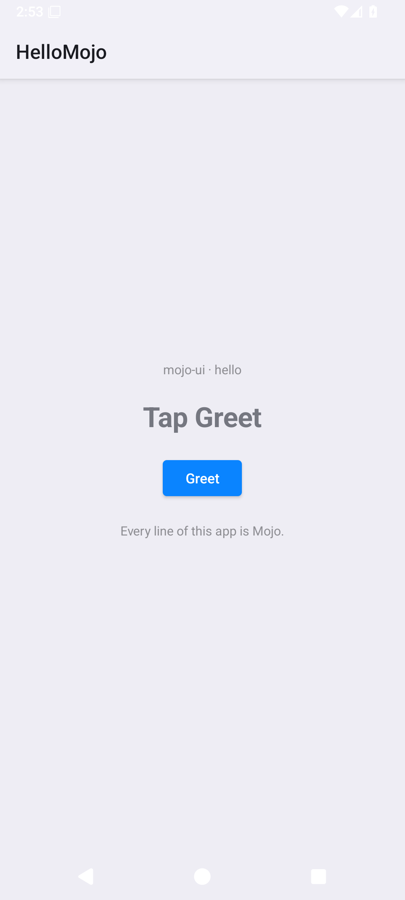
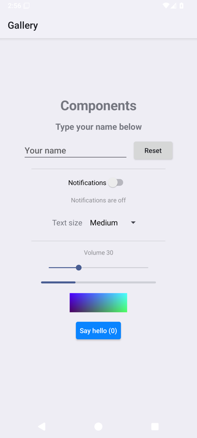
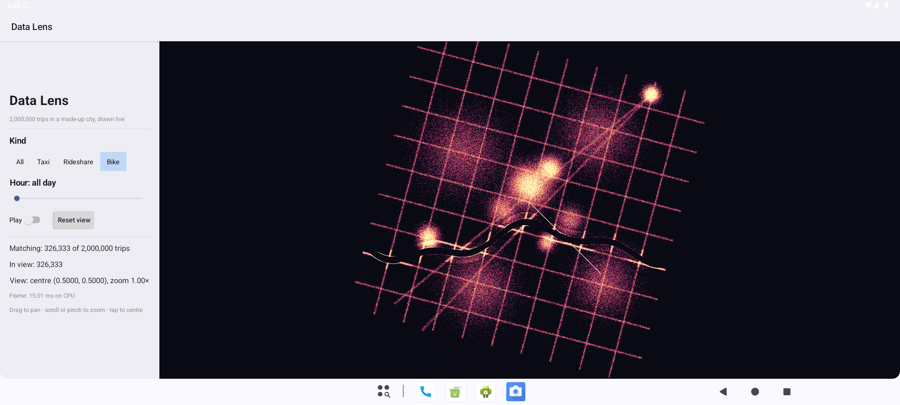

# Android

Status: **runs on the Android 16 emulator** (goal 7, 2026-10-15). The same `app.mojo` files become Android apps drawn with Android's own views. Not yet run on a physical phone: the APKs carry the arm64 library a phone needs, but no phone was connected.

| Hello | Gallery | Todo |
|---|---|---|
|  |  |  |



## What runs
- **hello, gallery, todo:** every goal-3 component (text, button, text field, switch, dropdown, slider, progress bar, image, divider, spacer, scroll). The gallery's and todo's test steps, done with real input (taps, typed keys, Return), end in exactly the same state as on GTK.
- **layout:** every layout setting (padding, fixed/min/max sizes, fill, grow, justify, align), measured from the real views' bounds with goal 5's rules. Tabs, segmented controls and radio buttons are `RadioGroup`s; long lists are `ListView`s that ask Mojo only for the rows on screen.
- **Data Lens:** the canvas is an `ImageView` showing a bitmap the app paints, with touch drags and pinches as PAN/ZOOM events and Android's frame clock (`Choreographer`) for animation. It uses the CPU path, so 2 million trips instead of 20 (about 15 ms a frame on the emulator). A real swipe pans it exactly as a drag does on GTK.
- **Not yet:** alerts, the date picker, icons and the nav bar are placeholders (goal-4 components come next), and the GPU path is compiled out.

## How it works
Android's views are Java objects, so the host talks to them through **JNI**, Java's C interface. Every native call gets a `JNIEnv`: a table of functions (`FindClass`, `NewObjectA`, `CallVoidMethodA`…). `mojoui/hosts/jni.mojo` calls them by their slot in that table, cast to each call's C signature. It's the same trick `objc.mojo` uses for `objc_msgSend` on Apple, with no binding generator and no C.

`mojoui/hosts/android.mojo` builds the views: `LinearLayout` for stacks (layout settings become `LayoutParams`, weights, gravity and padding), `TextView`, `Button`, `EditText`, `Switch`, `Spinner`, `SeekBar`, `ProgressBar`, `ImageView`, `RadioGroup`, `ListView`, `ScrollView`. Each view's id is its node index + 1, so a callback names its node.

**The one Java file** is `mojoui/hosts/android/MojoActivity.java` (75 lines), part of the framework and never of an app. Android only calls Java objects back: click listeners, text watchers, adapters, frame callbacks. So this Activity loads `libmojoui.so`, calls Mojo's `create()`, and forwards every callback to Mojo (`event`, `touch`, `frame`, `row`). It's an Activity rather than a ~40-line listener used with NativeActivity (D-66). NativeActivity claims the window for native drawing and can't easily find app classes from its thread.

While Mojo changes views itself, a Java field (`quiet`) silences their listeners. The flag lives in Java because callbacks arrive re-entrantly (D-69, the same lesson as GTK).

## Building and running
```bash
scripts/android_setup.sh                       # once: SDK, licences (yours to accept), a phone
scripts/build.sh todo android                  # → build/todo/android/TodoMojo.apk (signed with a local debug key)
adb install -r build/todo/android/TodoMojo.apk # on a phone with USB debugging, or the emulator
```

The build cross-compiles the app and mojoui for `aarch64-linux-android29` (phones) and `x86_64-linux-android29` (emulators). It links each with `ld.lld` against empty libraries that only name Android's `libc`, `libm`, `liblog` and `libdl` (the same trick as `apple/sdk/`). Then it compiles the Java file with `javac` and `d8`, packs the manifest with `aapt2`, aligns the APK with `zipalign` and signs it with `apksigner`. The libraries contain no Mojo runtime library: the few runtime functions are Mojo (`mojoui/hosts/mojo_rt.mojo`).

**Built with `-D MOJOUI_ANDROID`:** this compiles out the GPU path, and uses `clock_gettime`, because Mojo's `perf_counter_ns()` calls Apple's `clock_gettime_nsec_np` even on Android (`mojoui/clock.mojo`).

## How it's checked
`scripts/check` boots the emulator (AVD `mojoui`, Android 16, x86_64) headless and installs each APK. `scripts/android_drive.py` then drives it with **real input** from `adb shell input`: taps, typed text, Return, swipes, and taps on the slider until it reads the value. It reads the state back from the real views with `uiautomator dump`, using the same step language and state lines as the GTK test mode and the web driver. It also checks the APK's signature and contents, and that the libraries ask Android only for libc/libm/liblog functions.

## Limits
- Not yet run on a physical phone.
- The Data Lens's sidebar is laid out for desktops; on a phone in portrait it leaves little room for the map. The checks run it in landscape at a lower screen density.
- One Java file (75 lines) remains, by design: Android only calls Java objects back.
