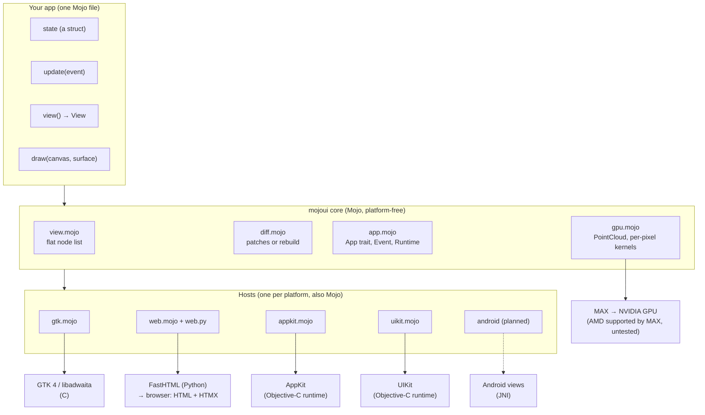
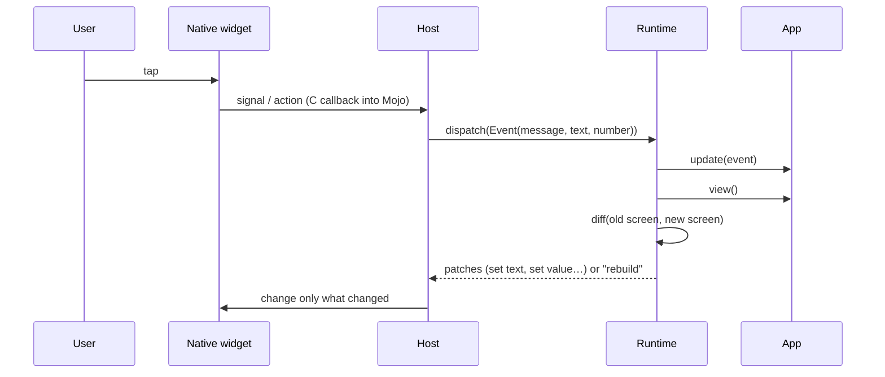
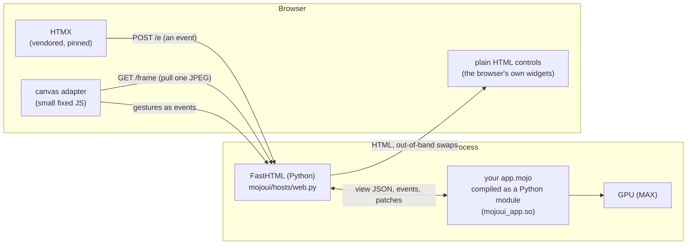

# How mojo-ui works

This is the deep dive behind the [README](../README.md): what each layer does, how Mojo reaches each platform, and why it's built this way. Every choice links to its entry in [decisions.md](decisions.md) (D-nn).

## The big picture



Three layers, and only the bottom one knows any platform:

1. **Your app** describes the screen as data and changes its state in `update()`. It imports only `mojoui` (`scripts/check` rejects anything else).
2. **The core** turns "the screen before" and "the screen after" into a short list of changes. It's plain Mojo with no platform code, so it's unit-tested on its own (`tests/test_mojoui.mojo`, `tests/test_canvas.mojo`).
3. **A host per platform** creates real native widgets for the screen, wires their events back to the app, and applies the changes. Hosts are also Mojo.

## The core: screens are data

A `View` is a **flat list of nodes**; node 0 is the root and containers list their children by index (D-14). It's flat partly because Mojo 1.1 can't put a `List[View]` inside `View`, but flat lists are also easy to compare and to pair one-to-one with native widgets.

```mojo
VStack(Text("Hi"), Button("Go", on_tap=GO))
# → [VSTACK children=[1,2]] [TEXT "Hi"] [BUTTON "Go" msg=GO]
```

Every interaction follows the same loop, on every platform:



- **Messages are numbers** (`comptime GREET = 1`). A widget never holds a closure; the host looks up the message in the current screen when the event arrives (D-19), so a message can change without rewiring anything.
- **Patches or rebuild:** same shape means small patches (new label text, new slider value). A different shape (a row added) means the host rebuilds the window's content. Rebuilds wait for the next idle moment, never inside the widget's own event, because GTK and AppKit would otherwise destroy a widget while it's still handling a click.
- **Layout** uses flexbox names (`.padding()`, `.grow()`, `.fill()`, `.align()`, `.justify()`), and each host maps them onto the platform's own layout system: GtkBox, CSS flexbox, NSStackView/UIStackView with Auto Layout. There's no layout engine of our own (ROADMAP decision 10): the translation stays thin.

## The bridge: Mojo speaks C

Everything below the core rests on one fact: **Mojo can call C functions, and C can call Mojo functions**, with no binding generator in between.

- **Calling out:** `external_call["gtk_button_new_with_label", Int](title)` calls a C function directly. When one C function is needed with several signatures (GTK's `g_signal_connect_data`, Objective-C's `objc_msgSend`), the host looks the function up once with `dlsym` and casts its address to the exact signature of each call (`ccall`, `msg`; D-02, D-10).
- **Calling in:** a Mojo function marked `abi("C")` is an ordinary C function pointer. GTK signal handlers, Objective-C methods and GPU kernels are all plain Mojo functions passed by address.
- **The platform owns the loop** (ROADMAP decision 2): GTK's main loop, `NSApplication run`, `UIApplicationMain` and the web server call into Mojo, never the other way round. iPhone requires this, and it works the same everywhere.

On Linux, Mac and iPhone there's no JSON and no message bus between the app and the screen: the app's state and the widgets live in one process and one memory. (The web host passes the screen to Python as JSON, inside one process.)

## Linux: GTK through C

`mojoui/hosts/gtk.mojo` builds GTK 4 widgets (with libadwaita's styling) for each node: `GtkLabel`, `GtkButton`, `GtkEntry`, `GtkDropDown`, `AdwToggleGroup`, `GtkListView`, `AdwAlertDialog` and so on.

- **Events** are GTK signals connected to Mojo functions. The handler finds its node from data stored on the widget and calls `send()`.
- **Re-entrancy:** GTK fires signals *while* we change widgets (setting a slider's value fires "value-changed"). A busy flag stops those echoes. It's kept on the GApplication object rather than in a Mojo field, because the compiler may assume a Mojo field can't change during a `mut self` method (journal, goal 3).
- **Canvas:** a `GtkPicture` showing a texture made from the app's pixels; a GTK tick callback (GTK's display clock) sends frame events and redraws; GTK's own drag, scroll, zoom and click gestures become PAN/ZOOM/TAP events. Ticks stop when nothing needs drawing, so an idle app doesn't wake the CPU (D-64).
- **Testing:** with `MOJOUI_TEST="tap:Greet;type:Name=Ada"` the same binary drives its real widgets through their normal APIs, prints what GTK reports, and quits. `scripts/check` uses this.

## Mac and iPhone: the Objective-C runtime, from Mojo

There is no Swift and no C in the Apple apps (D-01, ROADMAP decision 9). AppKit and UIKit are Objective-C frameworks, and Objective-C is a thin layer over a C runtime, so Mojo can talk to it directly:

- **Every call is a message:** `msg(button, "setTitle:", ns_string("Go"))` is `objc_msgSend(button, sel("setTitle:"), …)`, cast to that call's C signature (`mojoui/hosts/objc.mojo`).
- **Our own classes, made at run time:** `MojoTarget` (receives every control's action), `MojoCanvas` (an image view whose `scrollWheel:` is Mojo), and the iPhone's app and scene delegates are created with `objc_allocateClassPair`. Their methods are Mojo `abi("C")` functions.
- **Finding the node:** each control's `tag` packs the host's address and the node index (D-18).
- **Structs by value:** on Apple Silicon a CGRect or CGPoint travels in floating-point registers, the same as four (or two) separate doubles. Mojo passes and receives them that way, checked in the compiled code (D-03, journal goal 6).
- **Built on Linux:** Mojo cross-compiles to arm64 macOS/iOS object files; `ld64.lld` links them against small text stubs that only name Apple's libraries (D-05); the few Mojo runtime functions an app needs are themselves written in Mojo (`mojoui/hosts/mojo_rt.mojo`, D-04); `rcodesign` signs (D-09).
- **Canvas:** an NSImageView/UIImageView showing a CGImage of the app's pixels, a CADisplayLink for frames, and the platform's pan, pinch and tap recognisers.

**Not yet run on real hardware.** The calls are reviewed, the binaries are checked (entry point, linked libraries, only Apple system functions, signature), but nobody has launched them on a Mac or iPhone yet.

## The web: Mojo inside a Python web server

Mojo can't compile to WebAssembly yet (probed in goal 6), so the web version runs the Mojo app **on the server** and sends the browser plain HTML:



- **Mojo as a Python module:** `hosts/web_main.mojo` builds the app as a Python extension (`PythonModuleBuilder`). FastHTML keeps one app session per browser tab and calls `event()`, `view()` and `draw()` on it.
- **HTML and HTMX:** each node becomes a standard HTML control (`<button>`, `<input>`, `<select>`), so the browser draws its own native widgets. HTMX posts each event to the server; the server answers with just the changed controls as out-of-band swaps. Apart from the canvas adapter there is no custom JavaScript.
- **Canvas on the web:** a small fixed adapter in `web.py` pulls one JPEG frame at a time, painted by the Mojo app (on the server's GPU) at the canvas's real pixel size. It pulls at most once per display refresh, and a new pull starts only when the last frame has arrived, so a slow network gets fewer frames instead of a backlog (D-57, D-58). Gestures go back through HTMX as ordinary events.
- **Python's ecosystem, for free:** the app runs inside Python, so the server side can use any Python library, and the web host is FastHTML, a stack this project's owner already uses.
- **JavaScript's ecosystem, planned:** "islands" (ROADMAP decision 7) will let a node mount a JS library (a chart, a map, a code editor) into a placeholder, with a 10–30 line adapter per library, sending only meaningful events back to Mojo.

**Why the server, for now:** it works today, the browser stays tiny, and the server's GPU and Python libraries are right there. The costs are a round trip per interaction, bandwidth for canvas frames, and memory per tab (the Data Lens builds its 20M-point dataset per tab, D-60). When Mojo gains a WebAssembly target, the same app file can run in the browser instead.

## Android (next)

`scripts/build.sh todo android` already builds a real arm64 `libmojoui.so` that needs only Android's libc and liblog (`docs/android.md`). The plan mirrors Apple:

- **Drawing:** JNI gives native code a table of functions to create and call Java objects. That's the same role `objc_msgSend` plays on Apple, so Mojo drives Android's own views (`TextView`, `Button`, `EditText`…).
- **Events:** Android only delivers a tap to a Java object implementing a listener interface. A ~40-line Java class forwards every event to one Mojo function. It's the one non-Mojo file, part of the framework and never the app's; the owner approved this approach.

## The GPU

`mojoui/gpu.mojo` uses MAX (Modular's GPU runtime). The app writes **ordinary Mojo functions** and passes them as compile-time parameters; Mojo compiles them into GPU kernels:

- **Per-pixel:** `gpu.render[shade](w, h, params)` runs `shade(x, y, …) -> colour` once per pixel (the fractal example).
- **Point clouds:** `PointCloud(x, y, a, b)` uploads four float32 columns once. Each frame, `bin[place]` runs `place(point) -> pixel` for every point and counts the hits per pixel with atomic adds; `shade[colour]` turns each count into a colour; one copy brings the pixels back. That's 1.5–1.6 ms for 20 million points at 1080p on an RTX 3090 (across runs).
- **Same functions on the CPU:** without a GPU, `bin` and `shade` call the same `place` and `colour` on the CPU, so results are identical, just slower (checked pixel for pixel).
- **Apple:** the GPU path is compiled out of Mac and iPhone builds (`comptime if CompilationTarget.is_linux()`, D-56). MAX's Apple GPU runtime can't go into these runtime-free builds yet, so they use the CPU path.

## Why this design, for now

| Option | Good | Why not (for now) |
|---|---|---|
| **Our own GPU renderer for everything** (Flutter-style) | pixel-identical everywhere | rebuilds text input, accessibility and the platform's feel; a project of its own |
| **A web view everywhere** (Electron/Tauri-style) | the whole web stack | a browser in a box; GPU and data work in a second language |
| **Native skins in Swift/Kotlin fed with JSON** (ROADMAP decision 4, superseded by 9) | familiar tools on each platform | several codebases again, and data copied between languages |
| **Native widgets driven straight from Mojo, plus GPU canvases** (chosen) | native look and behaviour, one language, one memory, the GPU in the same file | each platform needs a host (once, in the framework); the web runs on the server until Mojo targets WebAssembly |

The deciding reason is the owner's vision: **one language, a very thin layer between the code you write and what runs**, with no app code in any other language.

## How it's proven

- `scripts/check` rebuilds everything from scratch and proves each milestone of the current goal (`GOAL.md`), plus every earlier goal's checks. It drives the real GTK widgets and a real headless Chromium with the same steps (`scripts/drive.py`), and requires both to end in identical states.
- Unit tests for the core (`tests/`), a GPU vs CPU benchmark (`tests/bench_lens.mojo`), and checks on the Apple binaries (allowed symbols, linked libraries, entry point, signature).
- Every goal ends with a reviewer pass; reports, decisions and dead ends are in `docs/`.
