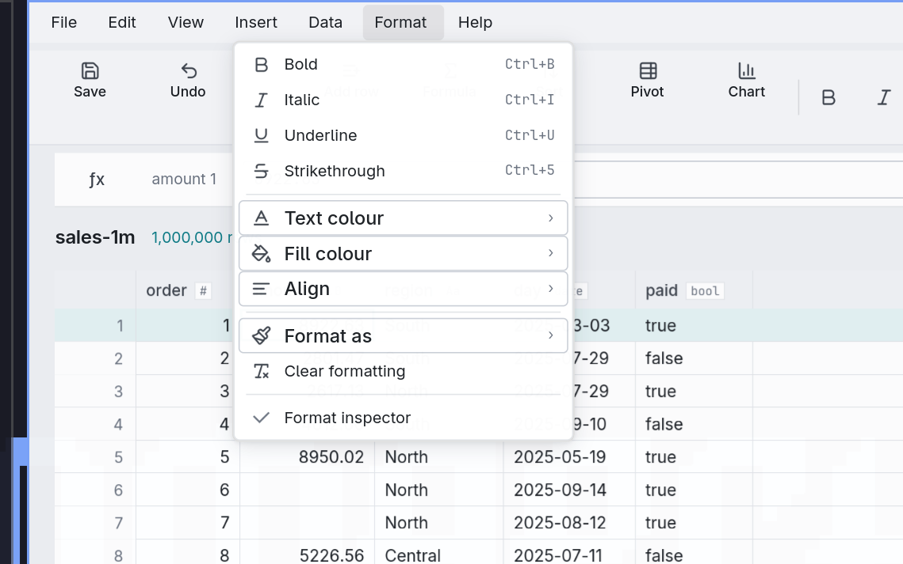
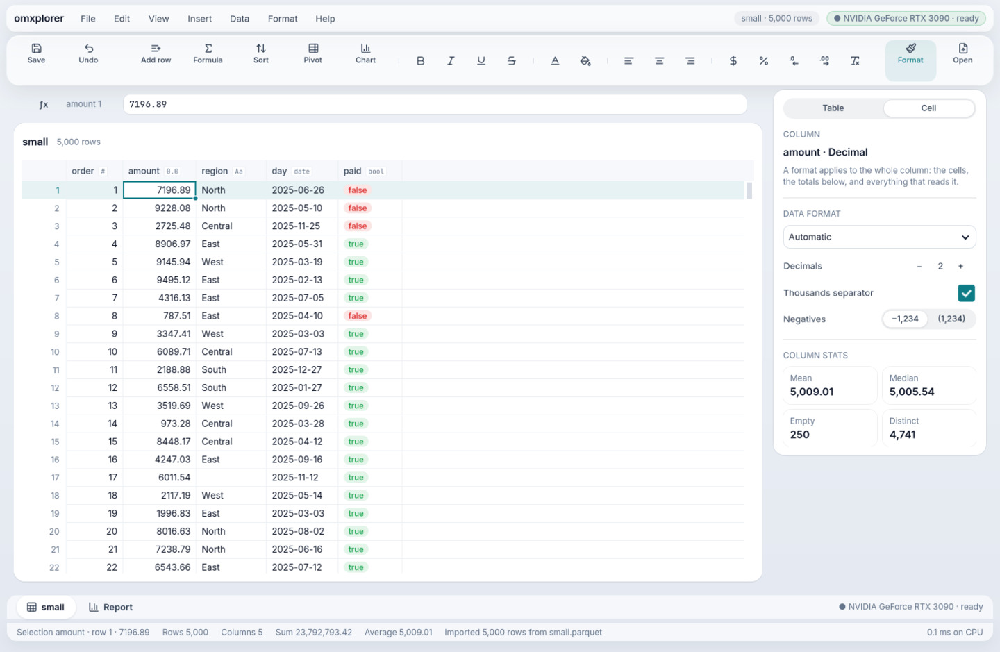
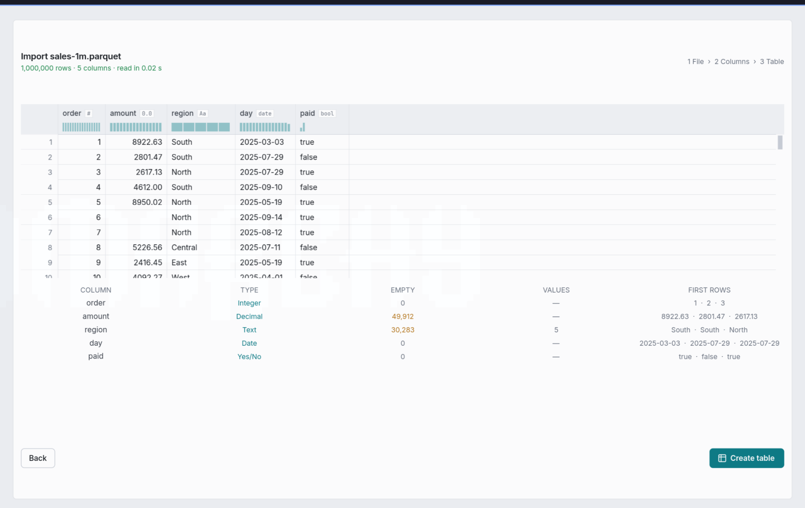
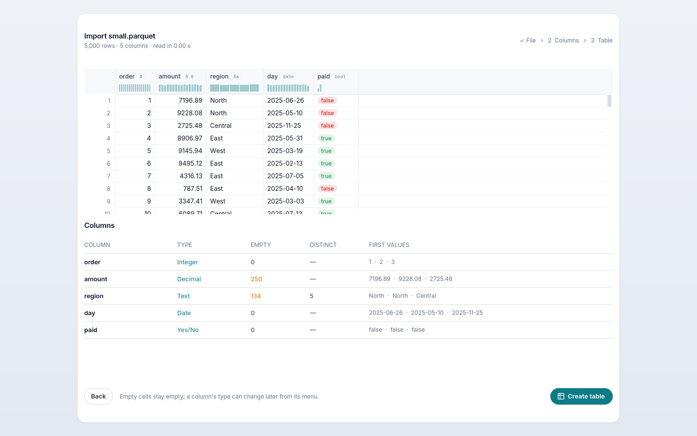
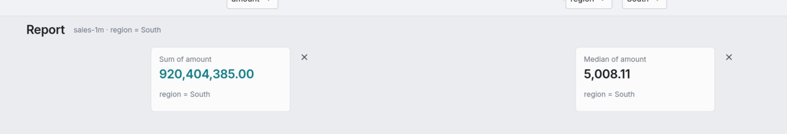
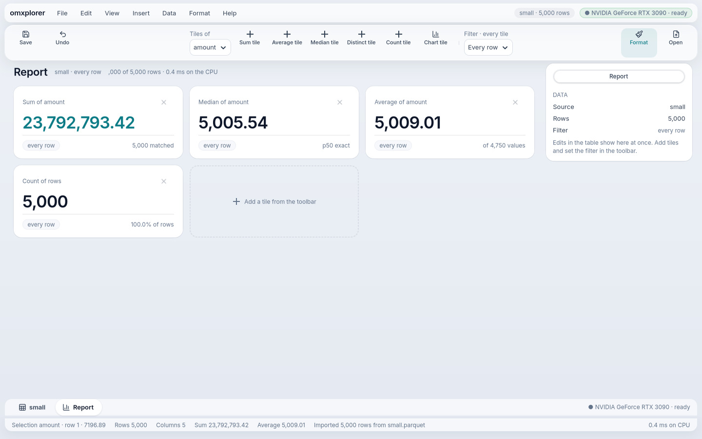

# Goal 24 report: omxplorer polished (Liquid, smooth, a showcase)

**End goal (owner, 2026-10-18):** take the components this framework already has, style them, and show an app "so liquid, so smooth, so fast that they are like wow": polish of the current features, not new ones. The owner picked Stitch's Liquid screens, with macOS-level fluidity.

## Result

M1–M7 PASS in one full run. The reviewer passed it on round 3.

```
PASS  M1  Stitch and Claude drafts of 5 screens side by side; the handoff names the choice, tokens, motion and gestures
PASS  M2  a fresh install is Liquid on GTK and the web, the other skins stay in Settings; floating islands on the backdrop
PASS  M3  menu rows one height and type; import table under its preview; tiles an equal-width grid with ✕ inside; tools one height; one type scale
PASS  M4  transitions and arrival animations on GTK and the web; the ring glides: [(13, 5.4, 'yes'), (12, 4.9, 'yes')]
PASS  M5  Shift+arrows, a drag and the agent select a block; its Sum, Average and Count are pyarrow's; Bold and Copy (TSV) reach every cell; GTK and the web
PASS  M7  the menu bar's name and GPU chip, yes/no pills, 4 stat cards, tile footers (matched, p50 exact, of N values, % of rows) on GTK and the web
PASS  M6  goal 23's M1–M3 (goals 3–22 inside them) pass  (2158 s)
```

## Before and after

| Before (the owner's screenshots) | After (GTK) |
|---|---|
|  |  |
|  |  |
|  |  |

Also in `docs/goals/24/`:
- a block of cells selected (`after-block.png`);
- the web versions (`after-*-web.jpg`);
- Stitch's sheet for comparison (`stitch-sheet.png`).

`build/g24/compare.html` sets Stitch, GTK and the web side by side.

## What changed

- **Liquid is a framework design** (`LIQUID`), not omxplorer's private skin, so the next apps get it for free (AG-UI screens, a video editor, simulations). It is omxplorer's default; Ledger, Graphite and Blueprint stay in Settings.
  - **Look:** the controls float on frosted-glass islands over a soft backdrop, the content is solid white, and one type scale runs through it all.
  - **On the web:** a real background blur and true spring curves.
  - **On Linux:** translucent glass, because GTK can't blur what is behind a widget.
- **Motion.**
  - Hover and press respond on springs; menus, dialogs and tiles arrive with a small overshoot.
  - The selection ring glides between cells: 12 to 13 frames per move, each drawn in about 5 ms.
  - A new `Surface.again` lets any canvas say "I'm mid-animation, draw me again".
  - Reduced motion makes the ring jump instead.
- **The screens you flagged.**
  - The Format menu's rows share one height and type.
  - The import dialog is a centred sheet with a left-aligned column table.
  - Report tiles sit three across with their ✕ inside.
- **Selecting a block of cells**, by drag, Shift+click or Shift+arrows.
  - The status bar shows the block's Cells, Count, Sum and Average.
  - Bold reaches every cell as one Undo step.
  - Copy puts tab-separated text on the clipboard, through a new declarative `Clipboard` view (GTK, web; Mac built, not run).
  - Blocks over 100,000 cells only report their size, so the window never stalls.
- **Stitch's details.**
  - The app's name, the document and a GPU chip in the menu bar.
  - Yes/no pills in the grid, and a faint dash for empty numbers.
  - Column stats as cards in the inspector.
  - Tile footers with a fact ("5,000 matched", "p50 exact").
  - A dashed Add-a-tile card.
- **Fewer rebuilds:** the status bar keeps fixed slots, so moving the selection patches texts instead of rebuilding the screen.

## Three decisions worth a second look

- **D-225: Liquid light with omxplorer's teal**, not Liquid's navy.
- **D-240: the Average tile's footer reads "of N values"**, not Stitch's "σ = …". The engine has no standard deviation yet; I added it to `needs-mxframe.md`.
- **D-238 / D-239: earlier goals' checks that assumed Ledger** now run as someone who picked Ledger. Their colour checks still mean what they did, and M2 proves the new default.

## Next

AG-UI generative interfaces on this baseline. In the meantime, goal 25 (MX frame dc1a722: SQL, FLOAT64) belongs to the mxapp-e6 session. On a real Mac, check that Cmd+C in a text field copies the field.
