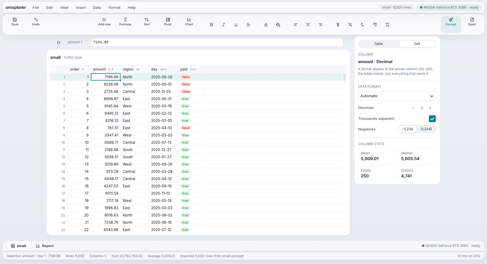
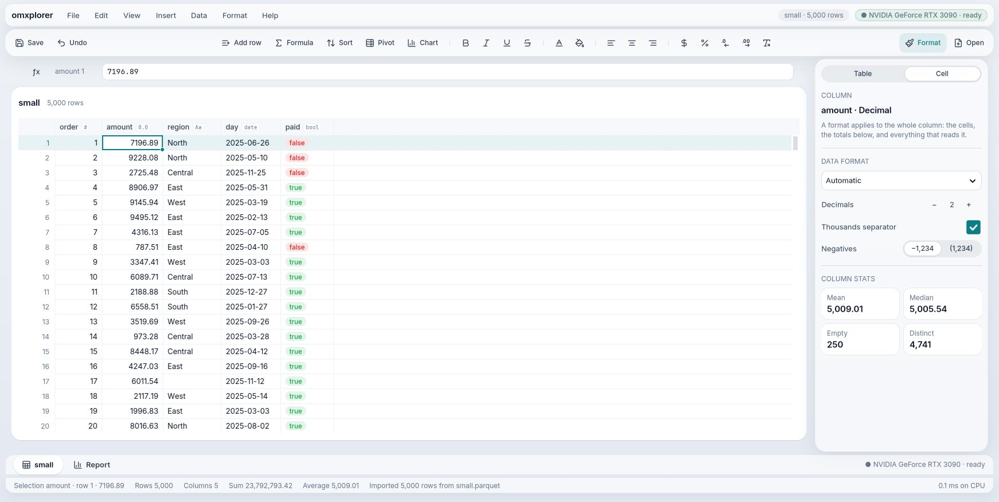
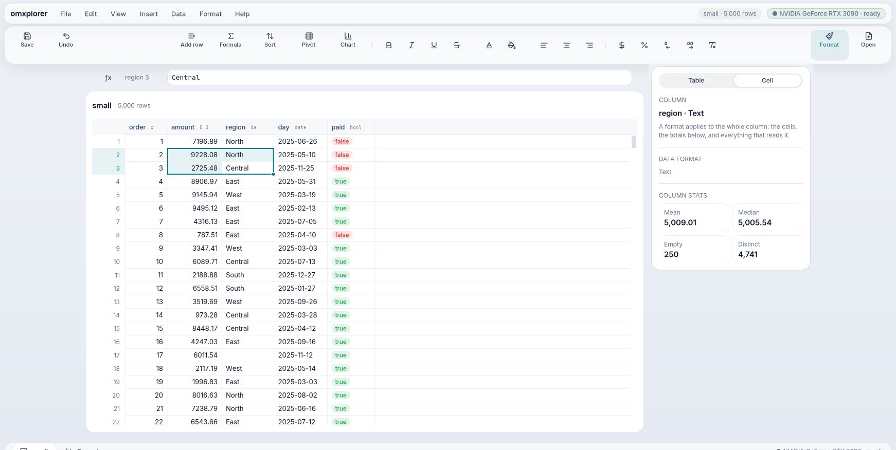
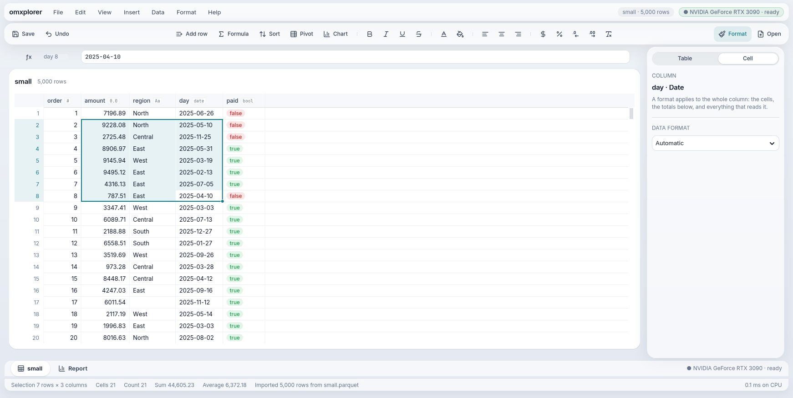

# Goal 25 report: omxplorer feels native (only what changed moves, it fits the window, nothing twitches)

**End goal (owner, 2026-10-19, after using goal 24's build):** "multi select does not work well… the icons on the toolbar are not in a straight line… the bottom bar is outside the screen for sheet… liquid feel more natural… there isn't a smooth feel to it. Is it implementation? Is the UI on a different thread, decoupled?"

## Result
M1–M7 PASS in one full run (goal 24's checks, and every earlier goal's inside them, as M7). Reviewer: round 3 PASS, then a final pass over the last fixes.
```
PASS  M1  the diff's tests pass; after the sheet opens every change is partial (10 updates, at most 15 widgets built); a real drag selects the 21-cell block (Sum 44,605.23)
PASS  M2  the sheet and the report fit 1742×876, 1280×720 and 2560×1400 on GTK and the web (status bar inside, no gap beside the inspector)
PASS  M3  every tool and toggle on one line, one height (GTK and the web, 1742 and 1280 wide)
PASS  M4  each column's inspector names it; order's and amount's Mean, Median, Empty and Distinct are pyarrow's; Text, Date and Yes/No offer no number settings
PASS  M5  hover and press ≤ 150 ms, menus 200 ms, dialogs 300 ms, tiles 320 ms, no overshoot, on GTK and the web; reduced motion turns arrivals off
PASS  M6  with real input in Liquid and Ledger: the preview scrolls, Back and Create table respond, nothing stray under the column table
PASS  M7  goal 24's M1–M7 (goals 3–23 inside them) pass  (2529 s)
```

## Your question: was it the implementation?
Yes. Measured with a new trace (`MOJOUI_TRACE=1`) and real mouse input:
- **Every change in the screen's shape rebuilt the whole window**: 150–190 widgets, 10–40 ms. Moving from a number column to a text column was enough (the inspector changes). Each rebuild replayed every arrival animation, reset hover and scroll, and **killed a drag in progress**: that was the broken multi-select.
- **The layout was made for a 1440×900 window.** On yours (1742×876) the bottom bar fell off.
- **One thread does everything.** That's normal (GTK and macOS keep the UI on the main thread); the rule is to keep that thread free. The app's own work per event is about 0.1 ms; drawing the grid on the CPU, 4–7 ms; opening a file still runs on it (215 ms for 5,000 rows): moving data work off it is a later goal.

## Before and after (your window, 1742×876)
| Before | After |
|---|---|
|  |  |
|  |  |

Before: the status bar is cut off; a real drag from amount stops at row 3 and the inspector shows amount's stats under "region". After: the window fits; the same drag selects the full 7 × 3 block (Cells 21, Sum 44,605.23, pyarrow's). Also in `docs/goals/25/`: the web (`after-sheet-web.jpg`), a 1280×720 report and toolbar.

## What changed
- **Only what changed is rebuilt** (framework, GTK). The diff keeps every widget it can and names the stacks, grids and Boards whose children changed. A column change now builds 1 widget in about 1 ms; a new report tile builds only that tile (the others don't arrive again); the cell editor no longer rebuilds the grid. Widgets keep stable ids, so the ones that stay need nothing new. `MOJOUI_NO_PARTIAL=1` turns it off to compare.
- **Apps know their window's size** (`App.resize`, GTK and the web). Size changes are patches, not rebuilds. omxplorer's sheet and report fill the window at any size; below 1440 pt the toolbar shows only icons.
- **One straight toolbar.** A new inline tool style (icon beside a short title) sits on one line with the format toggles, all one height.
- **The inspector follows the selected column**, during a block too, with the column's own numbers; Yes/No, Date and Text no longer offer decimals.
- **The import preview scrolls** (it ignored the wheel: likely the "stuck" you saw).
- **Calm motion.** One ease-out curve, no overshoot (the web's spring overshot by 16 % over 790 ms): hover 150 ms, menus 200, dialogs 300, tiles 320. Reduced motion turns arrivals off.
- **Fields are controlled**: when the app clears or changes a field after Return, the field shows the app's value.
- Smaller fixes found on the way: a spacer no longer makes a toolbar tall; a fixed-width panel no longer takes spare room; the report's "5,000 of 5,000 rows" lost its first digit (a byte count).

## Tools that came with it
- `scripts/live.py`: real mouse and keyboard (XTest) on the hidden display, and a report of the app's state on demand. It found the dead drag, which the usual test steps never could.
- `MOJOUI_TRACE=1`: each change's time and kind; rebuild, partial and draw times.

## Not proven or not done
- The faint magnified copy of the preview in your screenshot (GPU renderer at 1.6×) didn't reproduce here (cairo and software GL). If you still see it: `GSK_RENDERER=cairo scripts/omxplorer.sh` and tell me whether it goes.
- The web, Mac, iPhone and Android hosts still rebuild whole when the shape changes (they accept the same diff and ignore what it kept). The web's resize is a full rebuild too.
- Moving data work off the UI thread: a later goal.
- Controlled fields change one behaviour: the Workbook's Value field now goes back to the old value when a commit fails (the error stays on screen). Keeping the typed text there is a one-line app change, left for when the Workbook is next touched.

## Next
Goal 26: the GPU rendering spike (D-252, D-253, `docs/goals/26-draft.md`): the grid as a display list drawn by GTK's GPU renderer, the selection ring as its own layer. The bar: 120 fps on your 2.8k×1.4k window, ≤ 2 ms of main-thread work a frame, no grid repaints when only the ring moves. Then the showcase README. MX frame dc1a722 moves to goal 27.
