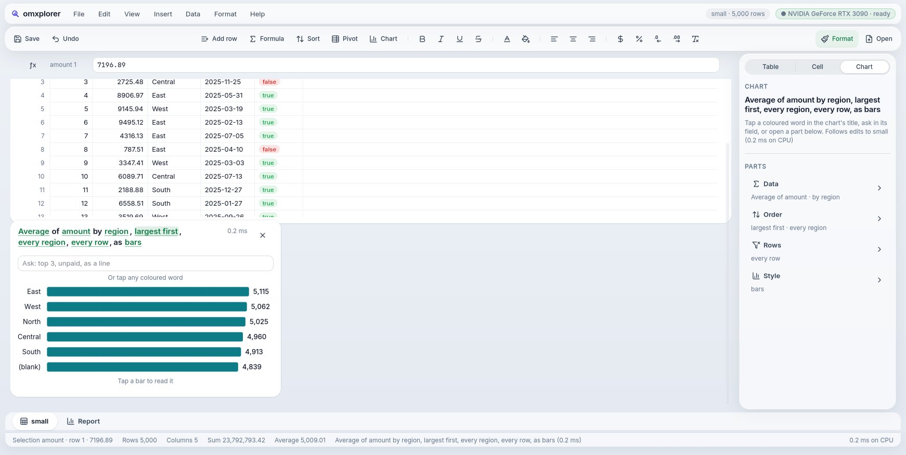
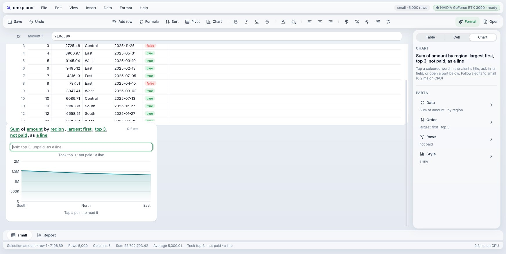
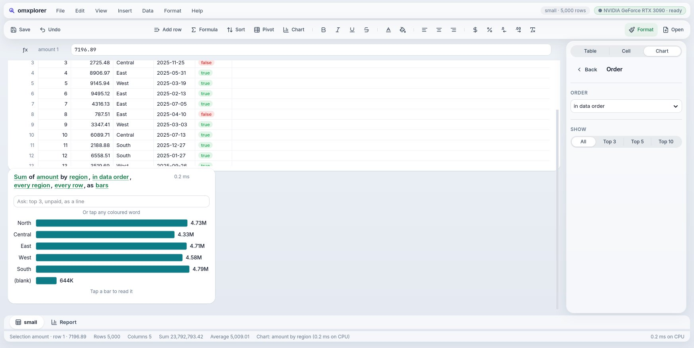
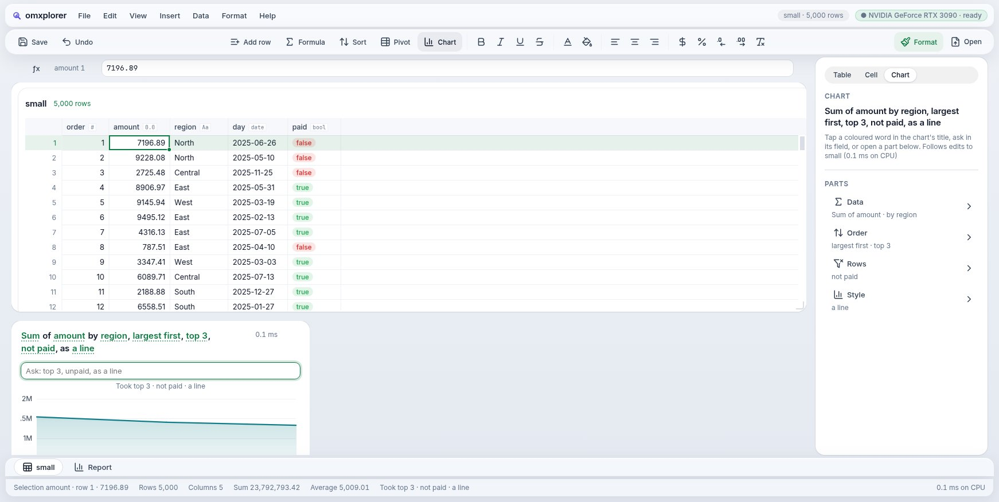

# Goal 28 report: editing a chart, the title is the query

**End goal (owner, 2026-10-19):** "charts can be on the inspector and a sub-inspector can have settings… be creative with UI… can't ship an Excel clone"; on the prototypes: "The title is the query: ask, then tap any word is the genius!!" And the standing bar: one language, every platform; the showcase dashboard with macOS polish, Linux speed and Windows usability.

## Result
M0–M7 PASS. Reviewer: round 2 PASS.
```
PASS  M0  12 specs (sum, average, count; in data order, largest, smallest, A to Z; top 2/3/5; paid or unpaid) equal pyarrow's; a document keeps a chart's spec and an older one opens as it was (tests/test_chartspec.mojo)
PASS  M1  a chart's title is its sentence, every setting a token (GTK, web); a token's choices open on it; Sum→Average, in data order→largest first, every region→top 3 change the chart on both hosts; a Report tile's too
PASS  M2  "top 3, unpaid, as a line" turns a chart into the top 3 regions' unpaid amounts as a line and says so (GTK, web, a Report tile too); nonsense changes nothing and says it; 37 phrases in tests/test_chartask.mojo
PASS  M3  a chart's inspector: its sentence and four rows saying what's set (Data, Order, Rows, Style); Order → Top 5 changes the chart, Back returns (GTK, web); a Report tile's Style page makes a line
PASS  M4  Undo takes back an ask (top 3), then the added row, then the earlier ask (average), each one step; a new chart opens its inspector; the toolbars only insert
PASS  M5  a re-order moves the bars over 21 frames after the pick (GTK), each ≤ 0.9 ms; the first frame is the old chart, the last exactly the new (tests/test_chartmove.mojo)
PASS  M6  real input: a click on Sum, Down and Return make it Average, the first bar reads pyarrow's mean; typing "top 3, as a line" and Return changes it; Ctrl+Z twice brings back the first chart
PASS  M7  goal 27's M0–M8 (goals 3–26 inside them, on the Scene and on pixels): every check passed in the full run but goal 15's M5, which read the chart's old title; it now reads the title's words (D-267) and passes on the same build
```

## What you can do with a chart now
A chart's title **is** its settings, as a sentence:

> **Sum** of **amount** by **region**, **in data order**, **every region**, **every row**, as **bars**

| Tap a word | Ask | Open a part |
|---|---|---|
|  |  |  |

- **Tap any coloured word** and its choices open on it: Sum, Average or Count; any number column; group by any text column; in data order, largest first, smallest first, A to Z; every group or the top 3, 5 or 10; every row, only paid, not paid, only West…; bars or a line. The arrow keys and Return work in the list, as in a native menu.
- **Ask** in the field under the chart: "top 3, unpaid, as a line", "average qty by product", "only West, smallest first". It changes several words at once, says what it took (and what it skipped), and the words that changed glow for a moment. It reads the table's own names too: columns, Yes/No columns, text values. It's a keyword reader (instant, offline), not a model: an agent can write the same sentence later.
- **The inspector** shows the sentence and what's set (Data, Order, Rows, Style); each row opens a page that slides in, with Back.
- **The bars move** to their new length and place (about 330 ms, the calm curve) instead of cutting.
- **Undo** takes back each chart change as one step, in order with your table edits (Ctrl+Z).
- Report chart tiles work the same way; Insert Chart opens the chart's inspector; the toolbars only insert.
- Saved in the document; older documents open as they were.

The same on the web: 

## Fixed on the way (all in today's build)
- **Undo right after Add row crashed the app** (the selection stayed on the removed row: the engine's bounds check aborted).
- **Picking a choice scrolled the sheet** by 90 pt (the keyboard going back to the grid scrolled to it): the host's own focus moves no longer scroll a board.
- **A line chart of a plain column read its values as cents** ($15K for 1.5M); its last label was cut off; its axis cut wide labels.
- A popover's choices had no keyboard (GTK gives popovers no arrow keys): focus goes in, Up/Down move.

## Your test
```
cd ~/Projects/mxapp/mojo-ui
scripts/omxplorer.sh build/data/orders_1m.csv
```
Insert → Chart (or the Chart tool), then tap "Sum" in its title, or type in "Ask": *top 5, largest first, as a line*. Ctrl+Z to step back. On the Report: Chart tile, same.

## Not done
- **Median per group, by month or week, ranges and several conditions** wait for MX frame 321870f (stable now): goal 29 vendors it and moves the charts' queries onto it, so the sentence gains "median", "by month", "over $1,000".
- The ask reads English keywords only; a value equal to a vocabulary word (a tier called "Top") wins over the word (D-266).
- Mac, iPhone and Android draw the sentence's words as plain buttons (no token style there yet); a dark Mac still draws charts light.
- The bars move on GTK, measured; on the web they move too but no check measures them.
