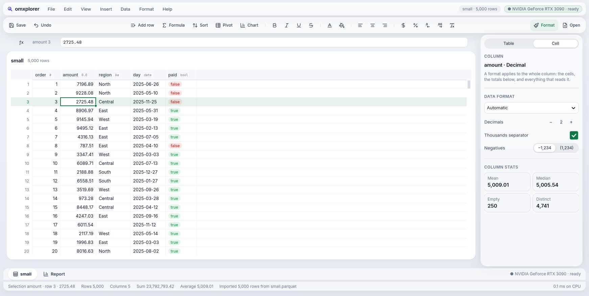
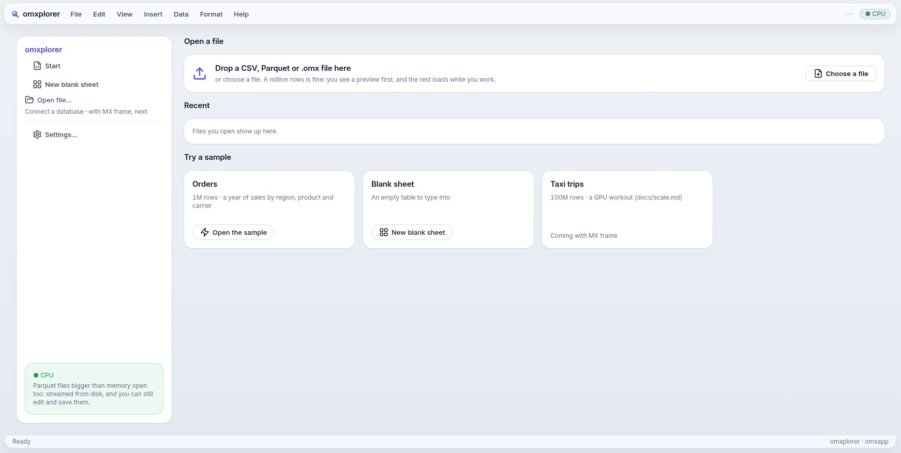
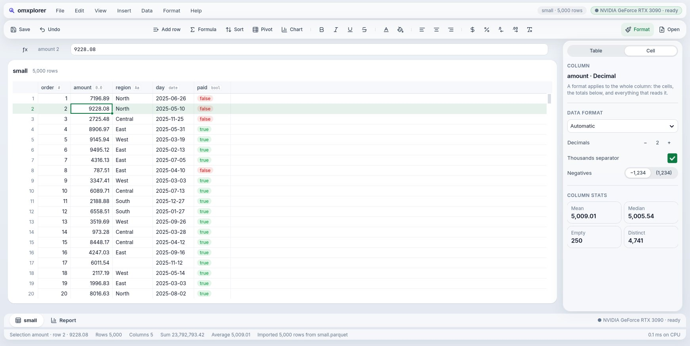
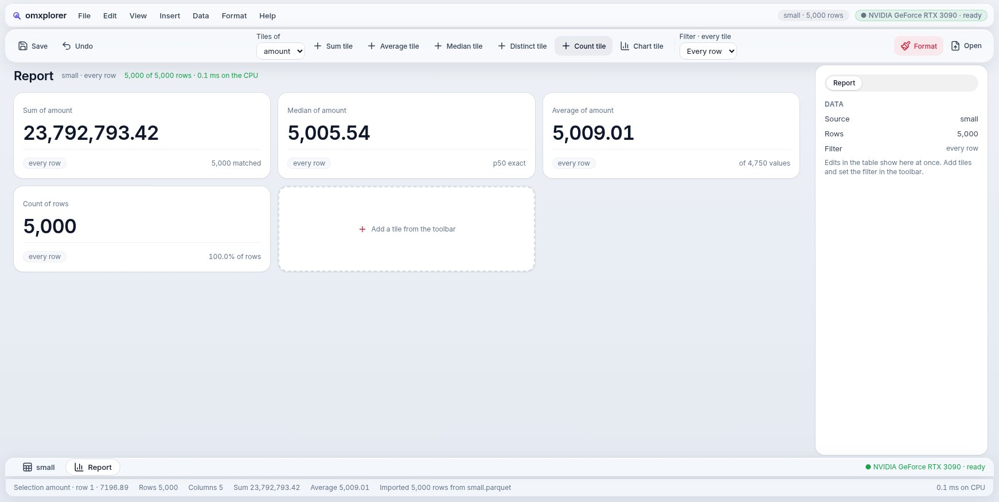

# Goal 26 report: the grid on the GPU (the Scene), your four fixes, the brand

**End goal (owner, 2026-10-19):** "we want a super fast app… it should feel like liquid. This is the whole point of the framework to exist… or else Rust guys will win." Plus four things from using goal 25's build (the drag lagging the cursor, the preview's scroll bar, lines in the inspector, the ✕ only on hover) and the brand you picked (Logo 1, Iris indigo, Ledger green, Signal red).

## Result
M0–M5, M7 and M8 PASS. M6 waits for you: it has to run on your screen (one command, below). Reviewer: round 3 PASS.
```
PASS  M0  the block follows the pointer mid-drag; the preview's scroll bar drags its rows; the inspector's sections have hairlines (GTK, web); a tile's ✕ shows only on hover (GTK pixels, web opacity)
PASS  M1  baseline, today's path: paint p50 14.2 ms p95 14.6 ms a frame + upload 0.8 ms (2180×1074 px, 1M rows)
PASS  M2  a Scene replays to exactly the pixels its calls draw (rect, rounded rect, line, circle, text, image, clip)
PASS  M3  the grid recorded as a Scene is the grid drawn (every pixel); layers cells, selection, ring, bar; the selection moving leaves the cells layer equal
PASS  M4  MOJOUI_SCENE=1 draws the grid as GPU render nodes (239 ops a frame); 0.00% of its non-text pixels differ from the pixel path
PASS  M5  scroll: 0.8 ms p95 a frame (build 0.2 + replay 0.6); glide: 0.2 ms, the cells layer rebuilt 0 times in 10 glides; 0 textures uploaded
BLOCK M6  120 fps on your display: waits for scripts/scene-bench.sh
PASS  M8  Logo 1 in the menu bar and window icon (GTK, web favicon); indigo on Start, green on the sheet (the ring too), red on the report's chrome with neutral figures; every accent ≥ 4.5:1 on white
PASS  M7  goal 25's M1–M7 (goals 3–24 inside them) pass, and its M1–M6 with MOJOUI_SCENE=1
```

## The headline number
Same window (2800×1400, your size at 1.6×), same 1M rows, same machine:

| Per frame, on the UI thread | Before (pixels) | After (Scene) |
|---|---|---|
| Scrolling | 14.2 ms paint + 0.8 ms upload | **0.8 ms** (p95) |
| The selection gliding | 14.6 ms + 0.9 ms | **0.2 ms** |
| Grid cells rebuilt while the ring moves | all of them | **0** |
| Textures sent to the GPU | 1 full-window texture | **0** |

**18× less work a scroll frame, about 75× less a glide frame.** At 120 Hz a frame has 8.3 ms; the old path couldn't fit one, the new one uses a tenth of it.

## How it works (plain version)
Before, Mojo painted every pixel of the grid on the CPU (2.3 million of them), then GTK copied the picture to the GPU. Every frame. Even when only the selection ring moved.

Now the grid's drawing code writes a **display list** (the Scene): "a rectangle here, the text 9,228.08 there", about 240 short instructions. GTK's GPU renderer (OpenGL or Vulkan on your machine) draws those. The list is cut into **layers**: cells, selection wash, ring, scroll bar. When the ring glides, the cells layer is byte-for-byte the same as last frame, so GTK reuses it untouched and only the ring is new. Text is laid out once by Pango (the system's text engine, Inter and JetBrains Mono) and kept.

It's the same drawing code for both paths (a `Painter` interface): the old pixel path stays as the reference and the fallback, and the tests prove the two draw the same grid pixel for pixel. The list is also readable: each piece of text knows its cell ("cell 0 7"), which an agent or a test can use.

| Pixel path | Scene path (GPU) |
|---|---|
|  |  |

## Your four fixes (M0)
- **The drag follows the cursor.** The block grows on every motion event, measured mid-drag with real mouse input ([mid-drag](goals/26/mid-drag.jpg)).
- **The import preview's scroll bar works** (drag it, the rows move).
- **The inspector has hairlines** between its sections and quiet section titles ([inspector](goals/26/inspector-lines.jpg)).
- **The ✕ on tiles and charts shows only on hover** (or while the tile has the keyboard) ([hover](goals/26/tile-x-hover.jpg)).

## The brand (M8)
Logo 1 (the lens over bars) in the menu bar, as the window icon and the web favicon. Each screen has its colour:

| Start: Iris indigo #4f46e5 | Sheet: Ledger green #0e7a43 | Report: Signal red #c8243f |
|---|---|---|
|  |  |  |

Figures stay neutral (no red numbers on the report: red reads as "bad"). Query and pipeline screens get a blue when they exist.

## Your test (M6, 2 minutes)
```
cd ~/Projects/mxapp/mojo-ui
MOJOUI_SCENE=1 scripts/omxplorer.sh build/data/orders_1m.csv     # try it: scroll, drag, glide with the arrows
scripts/scene-bench.sh                                           # the measurement: two windows open for ~1 min each, don't touch them
```
The bench writes `docs/goals/26/owner-run.txt`; M6 passes when ≥ 99 % of frames arrive on time. Your monitor runs at 60 Hz, so this proves "every frame on time at 60", not 120; the work per frame (0.2–0.8 ms) is what says 120 will hold. Without `MOJOUI_SCENE=1` you get today's pixel path, to compare.

## Not proven or not done
- **On a real GPU display:** all numbers above are from the headless test display (software rendering). The UI-thread work is real; how fast your RTX 3090 draws the nodes is M6.
- **Only the grid** uses the Scene. Charts, the import preview and the report still paint pixels (they're small; next to move).
- **GTK only.** The web, Mac, iPhone and Android hosts still use the pixel path. The Scene is built to map to Metal/Core Animation layers and the web's canvas the same way.
- Scrolling rebuilds the cells layer each frame (0.2 ms; the rows did change). Reusing rows that only shifted is a later step if it ever matters.
- Text edges differ slightly between Pango and our own rasteriser (1.3 % of pixels, all on glyph edges): the Scene's text is the system's, sharper at 1.6×.

## Next
- **Goal 27:** chart editing, "the title is the query" (ask, then tap any word), inspector sub-pages; the toolbar only inserts.
- **Goal 28:** the menu-bar island, option B (the glass pill).
- Then the showcase README, with these numbers.
